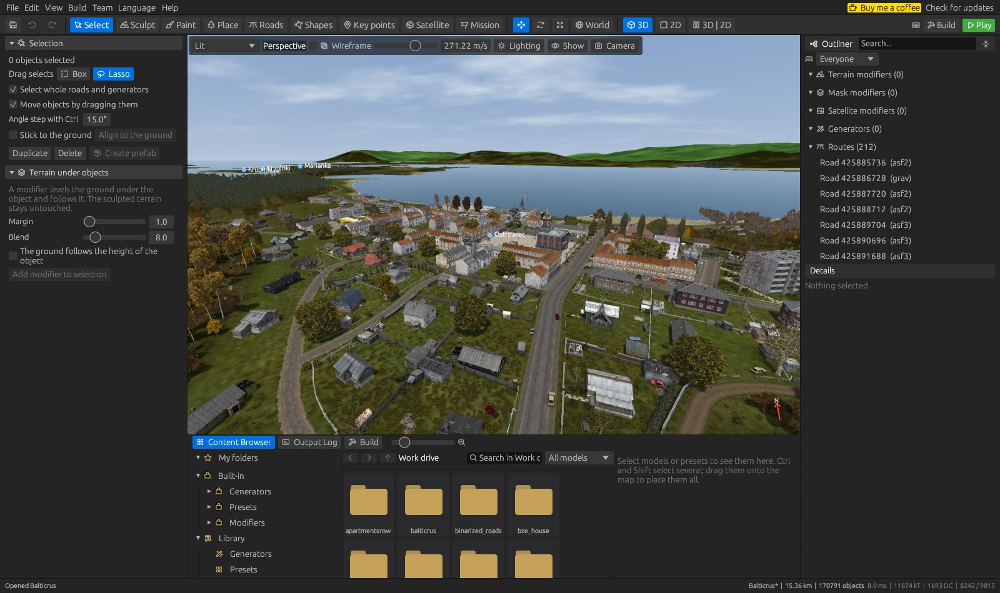
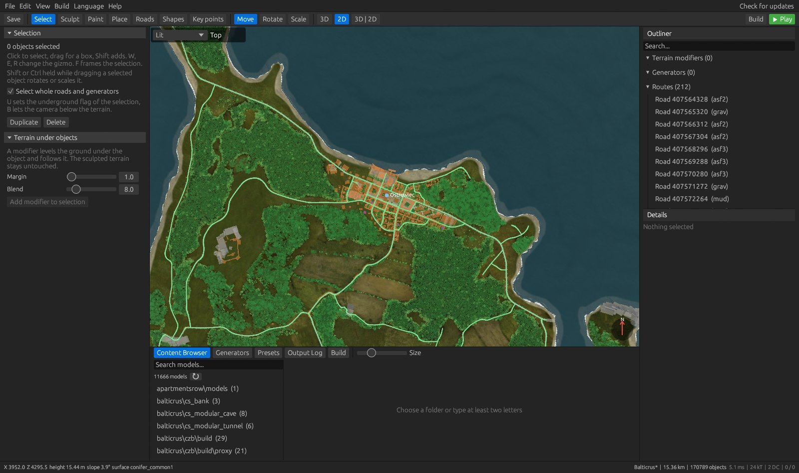
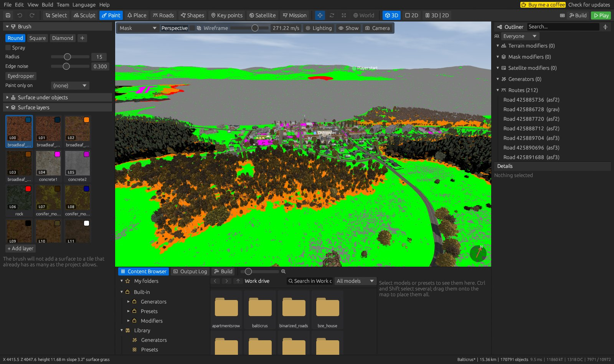
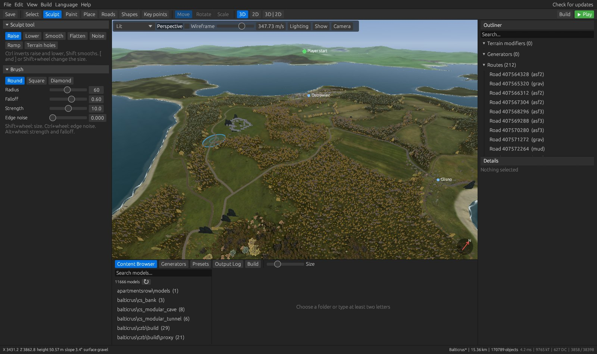
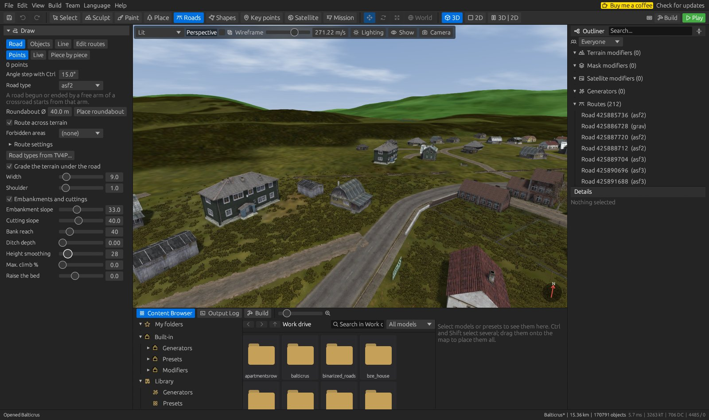
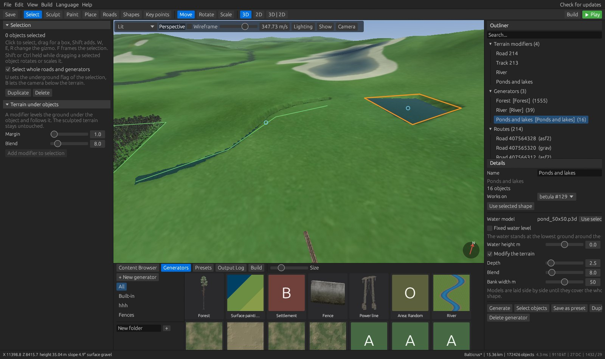
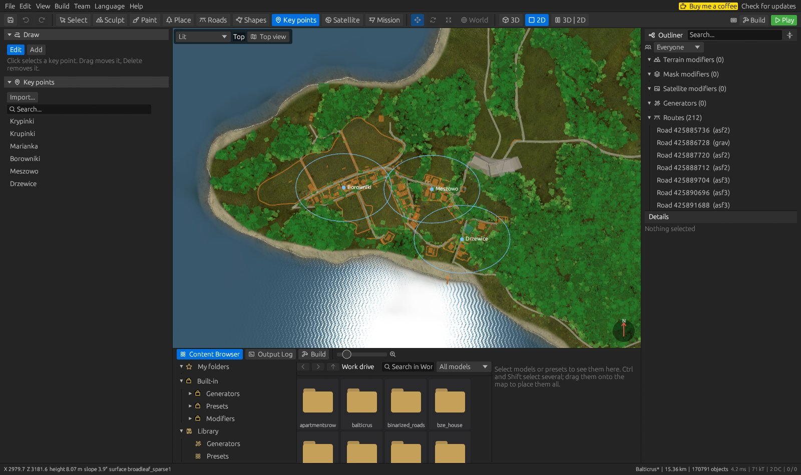
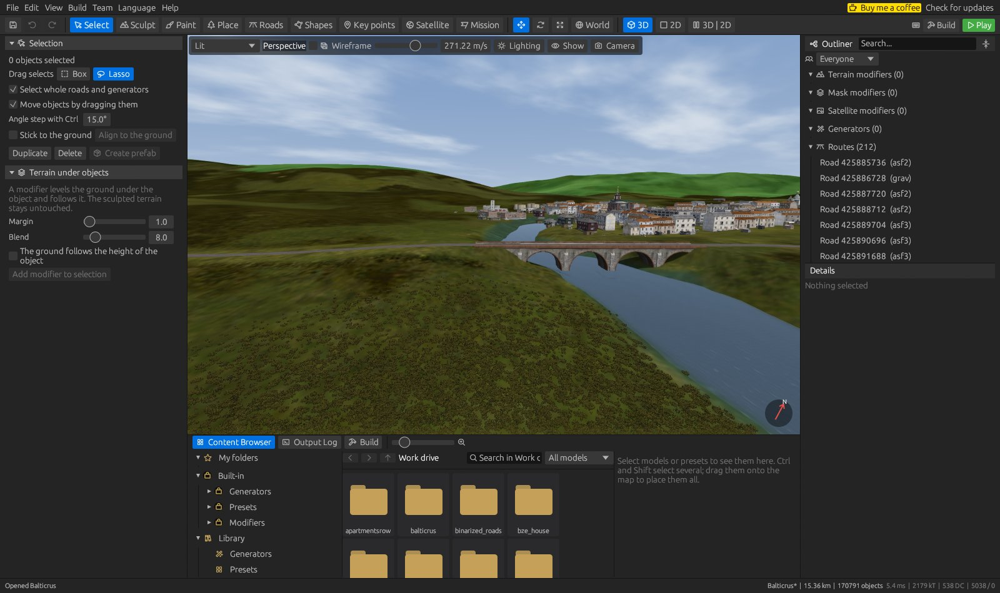

# DZ World Editor

**A complete DayZ map editor in one program.** Shape the terrain, paint surfaces, place objects, draw roads and railways,
generate forests and rivers, then build the map and start it in the game, without leaving the editor.



[**Download the latest release**](https://github.com/MrKamil404/DZWorldEditor/releases/latest) · Written in Rust · Windows 10/11 · English, Polish and German

## Features

- **Live 3D and 2D views** of the whole map with real DayZ models, textures, satellite image and water
- **Terrain** sculpting brushes, procedural terrain, hydraulic and thermal erosion, terraces and non-destructive modifiers
- **Surface painting** with per-tile limits that match what the game can render, up to six surfaces per tile
- **Object placement** from a searchable library of your `P:\` drive, with gizmos and undo
- **Roads and railways** fitted from the game's own parts, with embankments, bridges and level crossings
- **Generators** for forests, rivers, ponds, settlements, fences, power lines and more
- **Key points** for named places on the map, compatible with Terrain Builder
- **Terrain Builder import**, including layers, shapes, roads, key points and terrain holes
- **One-click build and test**: export, binarise with AddonBuilder and start a local server and client
- **Automatic backups** and a built-in updater
- **Team work** (experimental): several people work on their own copies and merge their changes through a shared folder, see [docs/team-work.md](docs/team-work.md)

## Screenshots

| | |
| --- | --- |
|  |  |
| **2D map view** with roads and town plans | **Surface layers** from your terrain materials |
|  |  |
| **Sculpting** with non-destructive terrain tools | **Roads and tracks** with graded beds and level crossings |
|  |  |
| **Generators** for forests, rivers and ponds | **Key points** imported from Terrain Builder |



*Screenshots show the Balticrus map, imported from its Terrain Builder project.*

## Getting started

1. Install [DayZ](https://store.steampowered.com/app/221100/DayZ/) and DayZ Tools, and mount the `P:\` work drive.
2. Download `DZWorldEditor.exe` from the [latest release](https://github.com/MrKamil404/DZWorldEditor/releases/latest) and run it.
3. Check the DayZ and DayZ Tools folders in `Edit > Settings`.
4. Create a new map, or use `File > Import` to bring in a Terrain Builder project.

You need Windows 10 or 11 and a graphics card with OpenGL 3.3. The model library and building a map need DayZ Tools and the `P:\` drive.

## Working on a map

| Key | Tab | What it does |
| --- | --- | --- |
| 1 | Select | Select objects, W/E/R gizmo, terrain modifier under the selection |
| 2 | Sculpt | Height brushes; Ctrl inverts, Shift smooths |
| 3 | Paint | Paint mask surfaces, with layers from `P:\dz\surfaces*` |
| 4 | Place | Click, or drag a model from the library |
| 5 | Roads | Roads, railways and objects along a line |
| 6 | Shapes | Draw polygons, lines and points that generators can work on |
| 7 | Key points | Add, move and edit named places |

**3D camera:** hold the right mouse button and use WASD/QE. Shift goes faster, and the wheel changes speed while the right button is held.
**2D view:** the wheel zooms, and the middle or right button pans.

Generators are in the panel at the bottom of the window. Drop one on a shape or a road, or select the shape first and double-click the generator.

| Generators | |
| --- | --- |
| Vegetation | Forest with extra presets and edges, area and line scatter methods |
| Water | Rivers from the game's straight and bend models, ponds and lakes that dig their own basins |
| Settlements and lines | Settlement, fence, power line |
| Terrain | Terrain shape, hydraulic and thermal erosion, terraces, terrain along a line |
| Surfaces and clean-up | Rule-based surface painting, removing objects by category or name |

## Importing

`File > Import` accepts a Terrain Builder folder (ASC, mask, satellite image, `layers.cfg`, object layers, shapes, TV4P with roads and key points, `holes.cfg`),
a built map on `P:\` (source WRP with its tiles), and DayZForests and `.dzroad` projects.
Binarised worlds (`OPRW`) cannot be opened.

## Building a map

**Build** exports the map to `P:\<map id>` and binarises its `world`, `data` and `navmesh` folders with AddonBuilder,
one PBO each, into `P:\Mods\@<map id>\Addons`. Anything else in the folder belongs to your mod and is left alone.

**Play** also creates a test mission and starts a `DayZDiag` server and client. Additional mod folders can be added on the Build tab.

The navmesh is prepared separately with `Build > Generate navmesh`: the editor starts the data server and NavMeshGenerator,
and the mesh is generated and saved as `navmesh.nm` in that tool. Without a navmesh the map runs, but AI does not walk.

## Backups

Besides autosave, the editor keeps complete copies of a saved project in the background. By default it makes one every 30 minutes, when
something has changed, and keeps the newest 10 in a `backups` folder inside the project. Files that did not change are shared between copies, so a backup of
a large map usually takes very little space.

The interval, the number of copies and the folder are in `Edit > Settings > Backups`. To restore a backup, open the `project.dzwe` inside it and use **Save as**.

## Building from source

```bash
cargo build --release -p dz-editor
```

The program is `target/release/DZWorldEditor.exe`. Run the tests with:

```bash
cargo test --workspace
```

## Adding a language

A file `%LOCALAPPDATA%\DZWorldEditor\lang\<code>.json` of the form
`{"__name__": "Language name", "File": "Translation"}` appears in the Language menu without rebuilding the program.

## Releases

A `v*` tag runs `.github/workflows/release.yml`, which tests the code and publishes `DZWorldEditor.exe`.
The program checks for the latest release at start and can install it.
