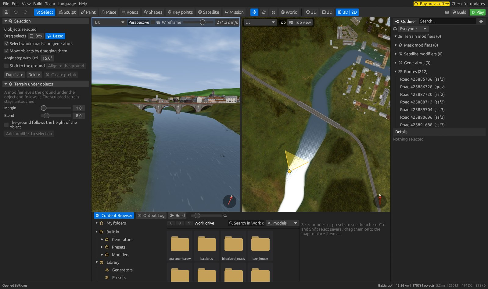
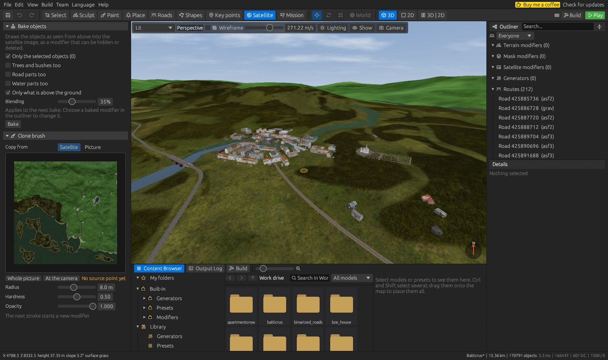
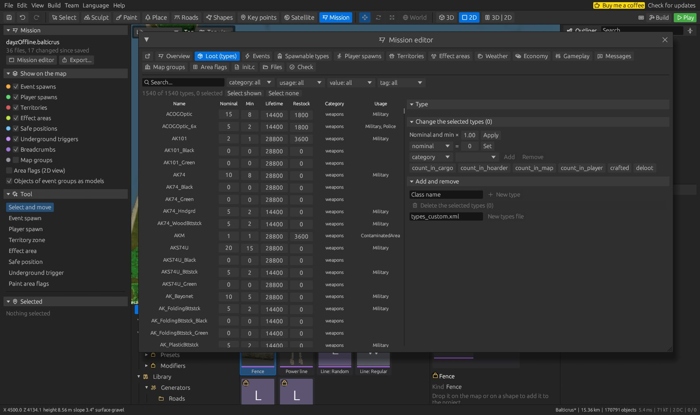

# DZ World Editor

**A complete DayZ map editor in one program.** Shape the terrain, paint surfaces, place objects, draw roads and railways,
generate forests and rivers, edit the server mission, then build the map and start it in the game, without leaving the editor.


[**Download the latest release**](https://github.com/MrKamil404/DZWorldEditor/releases/latest) · Written in Rust · Windows 10/11 · English, Polish and German

## Features

- **Live 3D and 2D views** of the whole map with real DayZ models, textures, satellite image and water; a split view, a minimap, full screen and a view in a window of its own
- **Terrain** sculpting brushes, terrain holes, procedural terrain, hydraulic and thermal erosion, terraces and non-destructive modifiers
- **Surface painting** with per-tile limits that match what the game can render, up to six surfaces per tile
- **Satellite image** editing: bake objects, roads and water into it, and a clone brush, all as modifiers that can be hidden or deleted
- **Object placement** from a searchable library of your `P:\` drive, with gizmos, angle snapping, painting objects with a brush, prefabs and undo
- **Roads and railways** fitted from the game's own parts, with embankments, bridges, level crossings and roundabouts
- **Every vanilla road type** of Chernarus, Livonia, Sakhal and Takistan, and **crossroads** (`kr_*`) that roads start from or that go into a road
- **Generators** for forests, rivers, ponds, settlements, fences, power lines and more
- **Key points** for named places on the map, compatible with Terrain Builder
- **Map config**: the `CfgWorlds` entry of the map, with its base world, map grid and main menu scenes
- **Terrain Builder import**, including layers, shapes, roads, key points and terrain holes, and import of built WRP worlds
- **One-click build and test**: export, binarise with AddonBuilder and start a local server and client
- **Automatic backups** and a built-in updater
- **Mission editor** (experimental): the economy, loot, events, spawns and the rest of the server mission, see [docs/mission-editor.md](docs/mission-editor.md)
- **Team work** (experimental): several people work on their own copies and merge their changes through a shared folder, see [docs/team-work.md](docs/team-work.md)

The [editor guide](docs/guide.md) describes every tab, the views and the menus in more detail.

## Screenshots

| | |
| --- | --- |
|  |  |
| **2D map view** with roads and town plans | **3D and 2D side by side** in the split view |
|  |  |
| **Surface layers**, here with the mask shown on the terrain | **Sculpting** with non-destructive terrain tools |
|  |  |
| **Roads** with graded beds, embankments and roundabouts | **Satellite image** baking and clone brush |
|  |  |
| **Generators** in the Content Browser | **Key points** imported from Terrain Builder |
|  |  |
| **Mission editor** with the loot table of a mission | **Bridges and rivers** from a Terrain Builder project |

*Screenshots show the Balticrus map, imported from its Terrain Builder project.*

## Getting started

1. Install [DayZ](https://store.steampowered.com/app/221100/DayZ/) and DayZ Tools, and mount the `P:\` work drive.
2. Download `DZWorldEditor.exe` from the [latest release](https://github.com/MrKamil404/DZWorldEditor/releases/latest) and run it.
3. Check the DayZ and DayZ Tools folders in `Edit > Settings`.
4. Create a new map with `File > New project`, or use `File > Import` to bring in a Terrain Builder project.

You need Windows 10 or 11 and a graphics card with OpenGL 3.3. The model library and building a map need DayZ Tools and the `P:\` drive.

## Working on a map

| Key | Tab | What it does |
| --- | --- | --- |
| 1 | Select | Select objects (box or lasso), W/E/R gizmo, terrain modifier under the selection, prefabs |
| 2 | Sculpt | Raise, lower, smooth, flatten, noise, ramp and terrain holes; Ctrl inverts, Shift smooths |
| 3 | Paint | Paint mask surfaces, with layers from `P:\dz\surfaces*` |
| 4 | Place | Click, paint with a brush, or drag a model from the library |
| 5 | Roads | Roads, railways and objects along a line, by points, live or piece by piece |
| 6 | Shapes | Draw polygons, lines and points that generators can work on |
| 7 | Key points | Add, move and edit named places |
| 8 | Satellite | Bake objects into the satellite image, clone brush |
| 9 | Mission | The server mission on the map (experimental) |

**3D camera:** hold the right mouse button and use WASD/QE. Shift goes faster, and the wheel changes speed while the right button is held.
**2D view:** the wheel zooms, and the middle or right button pans.
**Views:** Ctrl+1 is the 3D view, Ctrl+2 the 2D view and Ctrl+3 both side by side; F11 is full screen.

Every shortcut can be changed in `Edit > Keyboard shortcuts` (F1). F2 shows the keys of the current tool in the view.

Generators are in the Content Browser at the bottom of the window. Drop one on a shape or a road, or select the shape first and double-click the generator.

| Generators | |
| --- | --- |
| Vegetation | Forest with extra presets and edges, area and line scatter methods |
| Water | Rivers from the game's straight and bend models, ponds and lakes that dig their own basins |
| Settlements and lines | Settlement, fence, power line |
| Terrain | Terrain shape, hydraulic and thermal erosion, terraces, terrain along a line |
| Surfaces and clean-up | Rule-based surface painting, removing objects by category or name |

## Importing

`File > Import` accepts a Terrain Builder folder (ASC, mask, satellite image, `layers.cfg`, object layers, shapes, TV4P with roads and key points, `holes.cfg`),
a built map on `P:\` (source WRP with its tiles), a WRP world on its own, and DayZForests and Road Studio (`.dzroad`) projects.
Single parts (heightmap, satellite image, mask, `layers.cfg`, TV4L layers, object TXT files, TV4P roads and shapes) can be added to an open project.
Binarised worlds (`OPRW`) cannot be opened.

`File > Export` writes the same parts back out for Terrain Builder, and the server mission when the project has one.

## Building a map

**Build** (F7) exports the map to `P:\<map id>` and binarises its `world`, `data` and `navmesh` folders with AddonBuilder,
one PBO each, into `P:\Mods\@<map id>\Addons`. Anything else in the folder belongs to your mod and is left alone.

**Play** (F5) also creates a test mission, or uses the project's own mission, and starts a `DayZDiag` server and client. Additional mod folders can be added on the Build tab.

`File > Map config` sets the world config written to `config.cpp`: the name the game shows, the world it is built on,
latitude and longitude, the grid of the in-game map and the scenes behind the main menu, which can be taken from the 3D camera.

The navmesh is prepared separately with `Build > Generate navmesh`: the editor starts the data server and NavMeshGenerator,
and the mesh is generated and saved as `navmesh.nm` in that tool. Without a navmesh the map runs, but AI does not walk.

## Backups

Besides autosave, the editor keeps complete copies of a saved project in the background. By default it makes one every 30 minutes, when
something has changed, and keeps the newest 10 in a `backups` folder inside the project. Files that did not change are shared between copies, so a backup of
a large map usually takes very little space.

The interval, the number of copies and the folder are in `Edit > Settings > Backups`. To restore a backup, open the `project.dzwe` inside it and use **Save as**.

## Experimental features

The mission editor and team work are turned on with `Edit > Settings > General > Show experimental features`.
They work, but may still change.

## Building from source

```bash
cargo build --release -p dz-editor
```

The program is `target/release/DZWorldEditor.exe`. Run the tests with:

```bash
cargo test --workspace
```

## Adding a language

A file `%LOCALAPPDATA%\DZWorldEditor\lang\<code>.json` of the form
`{"__name__": "Language name", "File": "Translation"}` appears in the Language menu without rebuilding the program.
`Language > Open language folder` opens that folder.

## Releases

A `v*` tag runs `.github/workflows/release.yml`, which tests the code and publishes `DZWorldEditor.exe`.
The program checks for the latest release at start and can install it.
