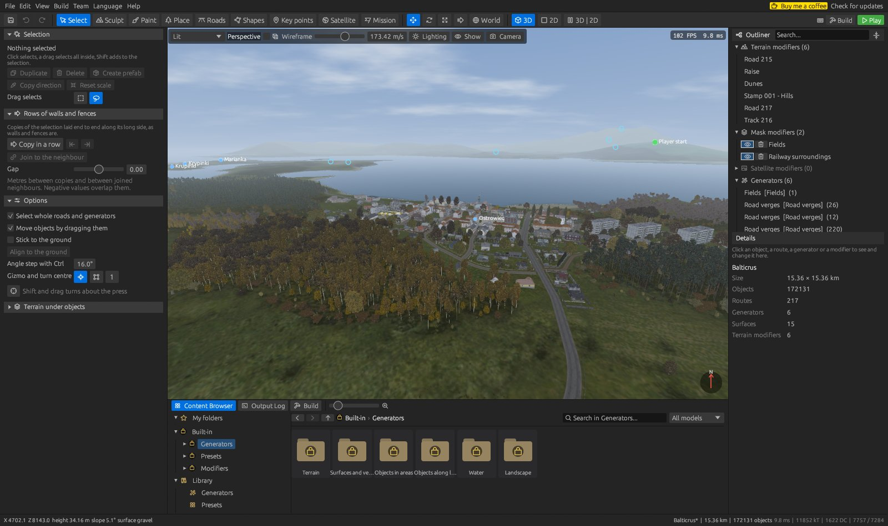
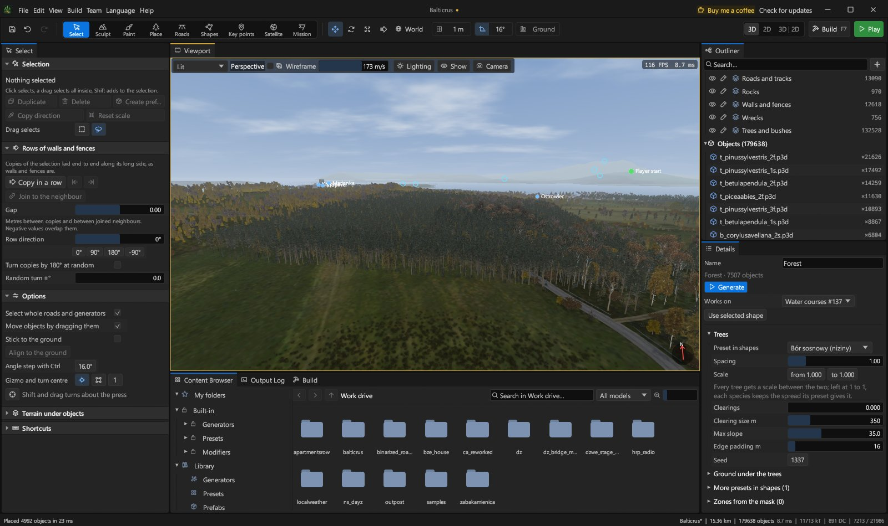

# Generators and the Content Browser

The Content Browser at the bottom holds:

* **Work drive**: every model of `P:\`, with thumbnails and a search.
* **Built-in**: generators, object presets, prefabs and modifiers that come with the editor. They
  cannot be changed, only duplicated. Forest presets are in **Built-in > Presets > Forests**, object
  presets (walls and fences with rare damaged pieces, rocks, wrecks, debris, street props) in
  **Built-in > Presets**, and ready-made scenes (*Bus stop*, *Forest camp*, *Hunting post*, *Road
  checkpoint*, *Military outpost*, *Transformer station*) in **Built-in > Prefabs**.
* **Library**: your own generators, presets and prefabs, in folders.
  To share them, right-click an item (or a folder, or the Library) and choose **Export to a file**.
  This makes a `.dzwelib` file. **Import from a file** adds the contents of such a file as new items,
  next to what you already have. A generator takes the object presets it uses along with it.
* **My folders**: models and presets you collect yourself, and Terrain Builder template libraries.

A generator is dropped on a shape, a road or the map (or select the shape first and double-click
the generator). It appears in the outliner, where its settings can be changed and it can be run
again.

Every field that holds a model or a preset (in generators, the Place tool, rows of walls and
fences, the bridge model) looks the same: a picture on the left, larger under the pointer, then
the name or a list with a search field, and three small buttons under it: take the one selected in
the Content Browser, show it in the Content Browser, and clear. Drop a model or a preset from the
Content Browser on the picture to use it. The list of forest presets says where each comes from:
this generator, the library, an object preset, or the built-in group.

The rules of Surface painting and of the Scatter generator have **More conditions** besides height
and slope: hollows and ridges (how far the ground lies below the ground round it), wetness (where
water runs and gathers), and the distance to water and to roads, each with ragged edges if wanted.
Moss in wet hollows, reeds along the water, dry grass on the crests, verges by the roads. Surface
painting also includes **Biome presets** (Central Europe, Summer, Winter & Volcanic, Desert, Alpine)
that match your existing layers automatically and can add any missing vanilla layers for you.

| Generators | |
| --- | --- |
| Vegetation | Forest (including orchard, windthrow, tundra and dead forest presets), orchard and vineyard rows, tree alleys, area and line scatter |
| Water | Rivers from the game's straight and bend models, ponds and lakes that dig their own basins, wetlands and marshes |
| Settlements and lines | Settlement, grid areas (cemetery, parking lot, container yard), fence, power line, trenches, tourist trail |
| Terrain | Terrain shape (including volcanic island, fjords, sand desert and karst), hydraulic and thermal erosion, terraces, terrain along a line |
| Surfaces and clean-up | Rule-based surface painting (with biome presets), removing objects by category or name |
| Landscape | Coast, cliffs and rocks, fields, wetland and marsh |
| Along roads | Road verges with bushes and signs, railway surroundings, wrecks and road decals, roadblocks and checkpoints, tree alleys, tourist trails |
| Round buildings | Things round the buildings already on the map |

* **Coast** paints beaches by the water and sand on the shallow sea floor (a layer named like sand,
  or else gravel), rock on steep shores, lays stones along the water and can lay the beaches to a
  gentle slope. It works on the whole map or inside polygons.
* **Cliffs and rocks** sets rocks of the game on steep slopes, facing down the slope and sunk into
  it, with a rock surface under them.
* **Fields** cuts polygons into strips of fields with balks between them, each strip sown with one
  of the chosen surfaces, and lays hay bales along them.
* **Orchard, Vineyard, and Tree alley** lay regular rows of fruit trees or vines inside polygons
  (with natural jitter, missing trees and ground surface), or a row of trees along both sides, only
  the left side, or only the right side of a road or line.
* **Wetland and marsh** uses terrain wetness and hollows to paint mud or peat and place reeds,
  willows and fallen logs.
* **Grid areas (*Cemetery*, *Parking lot*, *Container yard*)** fill polygons with regular rows and
  aisles, optional aisle props, position and rotation jitter, 180° flips and noise-clustered gaps so
  the layout looks natural rather than rigid.
* **Roadblock and checkpoint** snaps and aligns to a road, line or map point in military, civilian
  or mixed styles, placing barriers, wrecks, sandbags, hedgehogs, barbed wire and an optional guard
  shed.
* **Trenches** carves a zigzag trench into the terrain along a line, paints dirt on the mask and
  adds parapet sandbags, timbers/crates and barbed wire in front.
* **Tourist trail** follows a polyline or road (with smooth Bezier curves and side offset like
  roads), paints a narrow ragged footpath, clears trees and bushes from the corridor (restoring them
  if the generator is removed or re-run) and places colored trail marker poles, a start map board
  and resting benches.
* **Road verges** follows roads or lines: a verge surface, bushes beyond it and now and then a
  sign, a row of posts (poles, lamps) and stops with a platform. Dropped on the map, it follows
  every road, every railway or both.
* **Railway surroundings** is the same generator set up for tracks: a gravel ballast verge,
  bushes, signals, a row of telegraph poles and now and then a small station with its platform.
* **Wrecks and road decals** puts places with wrecks along roads: a jam of cars in a lane, a crash
  of two or three, or a car left on the verge, with oil stains under them, and cracks, patches and
  tyre marks on paved roads. Cars face the way the traffic of their lane goes; **Turn of the
  wrecks** turns them all (for models that face another way), and the random turn of cars in a
  jam and on the verge can be set. **Most metres from the middle** limits how far decals lie from
  the middle of the road, and **Keep decals inside the road** keeps wide ones nearer the middle so
  their edges stay on the road.
* **Things round buildings** dresses the buildings already on the map by their kind: woodpiles,
  bins and kennels at houses, pallets, barrels and tyres at works, sandbags and crates at military
  buildings, hay and logs at farms. Some stand against the walls, along them, the others free
  nearby; none inside another building or on a road. The game's models do not say where their
  doors are, so a thing can end up in front of one: move it, or run again with another seed.
* **Settlement** can take the game's buildings of a village, town, farm, industrial area or
  military base from the work drive, gives each building a yard with its own surface, and fences
  some of the plots, leaving the side to the street open.
* **Fence** sets wall or fence pieces along a line. With *Join the pieces at corners*, two more
  options help thick walls: *Close the corners of thick walls* lets the pieces on both sides of a
  corner reach past it by half the thickness of the wall, so the outer edge closes (where a wall has a
  pillar at one end, the pillar stands centred on the corner and the other wall ends in its middle).
  The panel shows how thick the pieces are at their ends, and *Set the reach at corners by hand* lets
  you choose how far the piece before and the piece after a corner reach past it; *Corner object*
  stands a post or corner piece (for example `Wall_IndVar1_Pole` or `Wall_CBrk_Corner`) on every
  corner and stops the pieces at its sides. Both can be used together.

[Back to the guide](guide.md)
