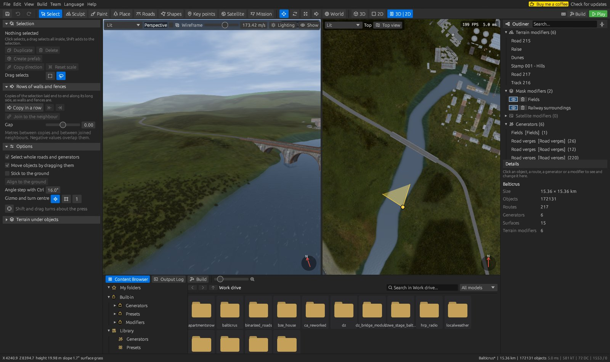
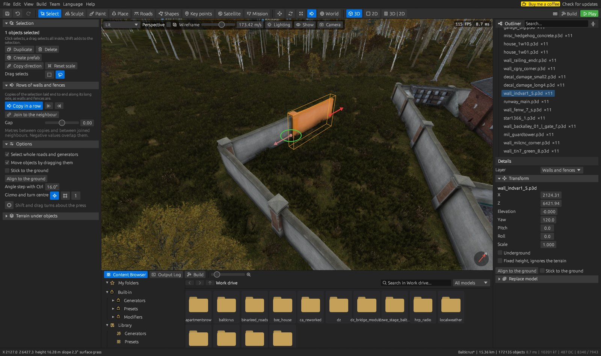
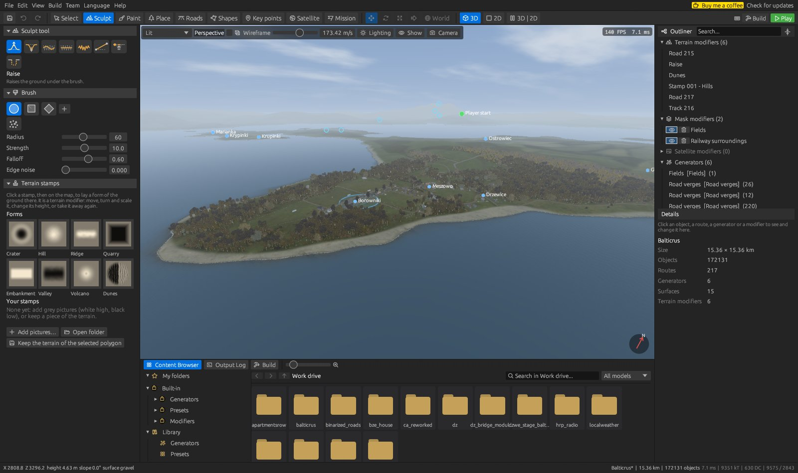
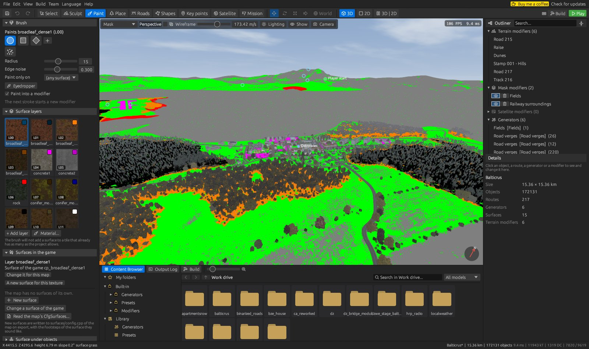
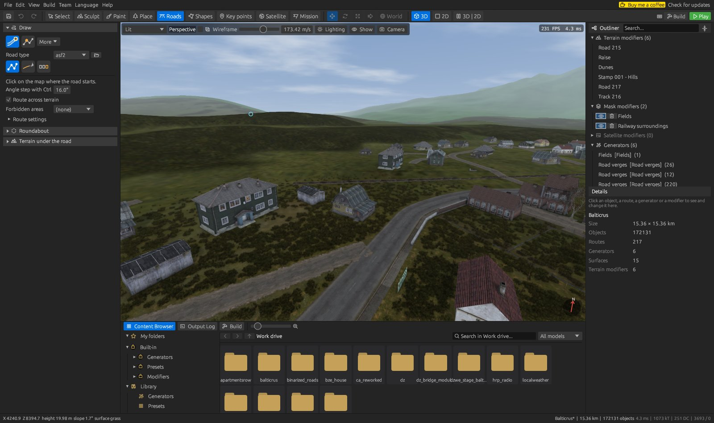
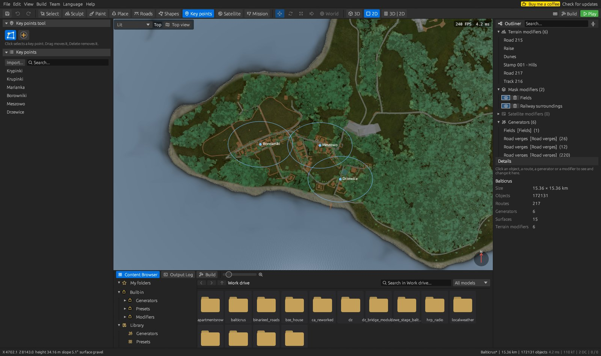
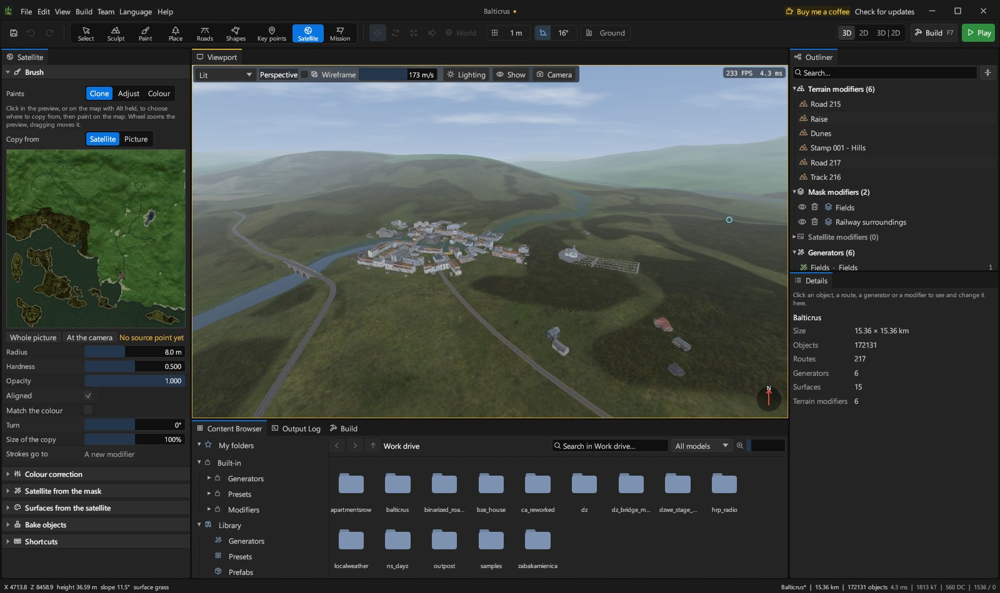
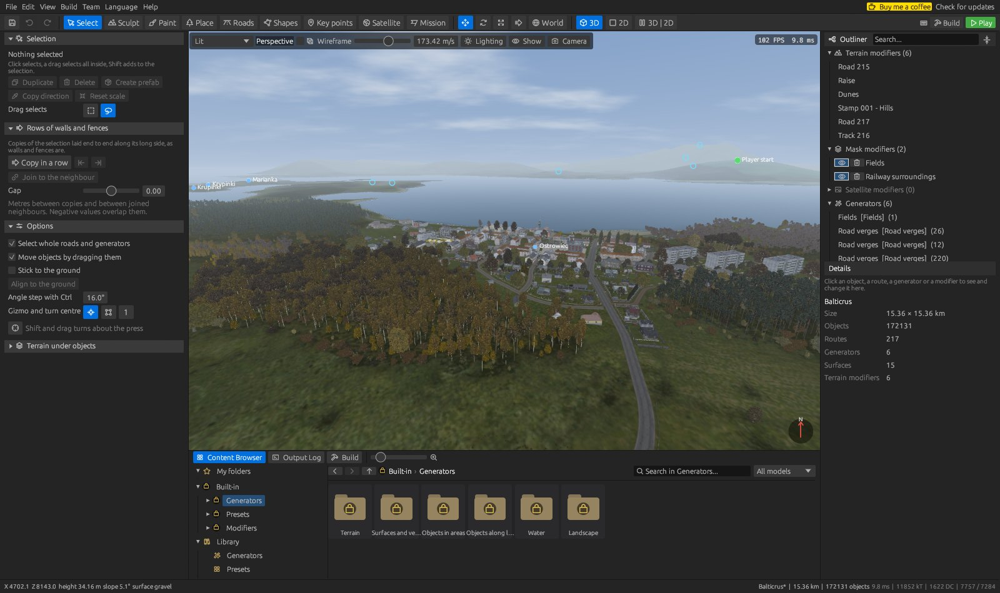

# Editor guide

This guide walks through the window of DZ World Editor, the views, every tab and the menus.
For the server mission see [mission-editor.md](mission-editor.md), for several people on one map
[team-work.md](team-work.md).

## The window

* **Menu bar**: File, Edit, View, Build, Team (with experimental features on), Language and Help.
  On the right, *Check for updates* and the installer of a new release.
* **Toolbar**: Save, Undo and Redo, the nine tabs (keys 1-9), the gizmo (Move, Rotate, Scale, Copy in
  a row, and World or Local axes), the views (3D, 2D, 3D | 2D) and **Build** and **Play**.
* **Left panel**: the settings of the current tab.
* **View**: the map in 3D, in 2D, or both side by side.
* **Outliner** (right): terrain, mask and satellite modifiers, generators, roads and object
  layers. Click one to select it; the **Details** below it shows and changes what is selected.
* **Bottom panel**: the **Content Browser**, the **Output Log** and the **Build** tab.
* **Status bar**: the position, height, slope and surface under the pointer, the map and the number
  of objects, and what the renderer draws.

## Views and camera

| | |
| --- | --- |
| 3D view (Ctrl+1) | Hold the right mouse button and fly with WASD, Q and E. Shift is faster, the wheel changes the speed while the right button is held. F frames the selection, B lets the camera below the terrain. |
| 2D view (Ctrl+2) | A view from the top. The wheel zooms, the middle or right button pans. Close up, it draws the models themselves, as a drone sees them. |
| 3D \| 2D (Ctrl+3) | Both views side by side. The top view can follow the 3D camera, and the two can be swapped or stacked. |

**View > Measure** (ruler) measures on the map: each click adds a point, and the view shows the
length on the map and along the ground, the climb from the first point to the last and, from three
points, the area they close. Backspace takes the last point back, Esc or a right click ends.
**View > Saved views** keeps places of the 3D camera in the project to go back to with a click.
**View > Go to** (Ctrl+G) flies the camera to a place. Type the name of a key point, a square of the
game's map grid (`045 123`: the east number first, squares of 100 m from the south west corner) or
metres east and north with a comma (`4500, 12300`), and press Enter. Right click a key point, modifier,
generator, road, shape, shape layer or model in the Outliner and choose **Move the camera here** to
fly to it.

The bar at the top of each view chooses the shading (Lit, Satellite, Mask, Hillshade, Height,
Slope, Water flow), wireframe, the speed of the camera, **Lighting** (sun, shadows), **Show** and **Camera**.
**Lighting** also has **Time of day** and **Overcast**: the sun of that hour at the map's
latitude and start date, weaker and with more fog under cloud. **Show** and the View menu turn parts of the map on and off: grass (G), objects (H), shapes
(Shift+H), the land grid and texture tiles.

`View > Full screen` (F11) gives the whole screen to the view; move the pointer to an edge for the
panels. `View > View in a separate window` moves the view to a window of its own, for example on
another screen. The minimap in the corner of the 3D view can be dragged bigger or smaller and turned
off in the settings.

## Tabs

### 1 Select

Click selects an object, a drag selects with a box or a lasso, Shift adds. W, E, R and T switch the
gizmo between move, rotate, scale and copy in a row, L between world and local axes. With objects selected, a drag
with Shift held turns them, Ctrl+Shift turns them by steps (the wheel changes the step) and Alt
scales them.

* **Select whole roads and generators** picks a road or a generator as a whole instead of its
  objects.
* **Move objects by dragging them**: an object held by its shape slides over the ground.
* **Gizmo and turn centre** chooses where the gizmo stands and what the selection turns about: the average of the object positions (the default), the middle of the box that holds them, or the first selected object. Only positions count; the models are not looked into. **Shift and drag turns about the press** makes a Shift drag turn the selection about the spot of the ground where the button went down.
* **Stick to the ground** tilts moved objects with the ground; **Align to the ground** does it now.
* **Duplicate** (Ctrl+D) and **Delete**. C copies the selection to the cursor, V copies the last
  selection there again.
* **Copy direction**: click it, then click another object. The selection turns the way that object
  faces, so a broken wall lines up with the wall next to it. With *Stick to the ground* only the
  heading is taken and the objects tilt with the ground.
* **Reset scale** sets the selected objects back to their own size.
* **Create prefab** makes a reusable group of the selected objects in the library.
* **Rows of walls and fences**, a section of its own, lays copies of the selection end to end:

  

  * **Copy on ahead** (Ctrl+Shift+D) and **Copy on behind** (Ctrl+Shift+A), the arrow buttons, put a
    copy of the selection right next to it along its long side and select the copy. Press again to
    lay a row of walls or fences piece by piece.
  * **Copy in a row** (T, the fourth gizmo button) shows two arrows where the selection ends along its
    long side. Drag an arrow out: an outline shows each copy that fits up to the cursor. Pull aside to
    turn the row about the end of the selection; with Ctrl it turns by the angle step (the wheel
    changes the step). When you let go the copies are laid and the last one is selected, so the next
    drag goes on from there, round a corner if you like. The green ring turns the selection about the
    point where it joins the wall or fence next to it: grab it and the selection first moves back to
    meet that end, then turns about it (with Ctrl by the angle step), so it stays joined.
  * **Join to the neighbour** (J) moves the selection so its end meets the end of the object next to
    it, for example after turning it with the usual gizmo.
  * **Gap** sets the metres between copies and between joined neighbours; negative values overlap
    them.
  * **Row direction** turns the way the row goes (and its arrows) from the long side of the first
    object, by any angle: drag the slider, type a value, or click 0°, 90°, 180° or -90°. For models
    whose copies belong another way, such as posts or gates.
  * **Turn copies by 180° at random** and **Random turn ±°** turn the new copies about their own
    middle, so a row shows both sides of a wall or looks less straight. The outlines while dragging
    show the turns the copies will get.
* **Terrain under objects** adds a terrain modifier that levels the ground under the selection and
  follows the objects when they move. The sculpted terrain stays untouched.

The **Details** under the outliner show the selected objects: position, angles and size, typed in,
**Underground** and **Fixed height, ignores the terrain** (the height is then measured from sea
level). **Replace model** puts another model in place of the selected objects: choose models in the
Content Browser, or drop one on it. Where the objects stand, how they are turned and their size stay;
with several models each object takes one of them.

### 2 Sculpt

Raise, Lower, Smooth, Flatten, Noise, Ramp, **Set height** and **Terrain holes**; the tools are
icons, and the tip says what each one does. **Set height** paints the ground to a height you copy
from the map: right click the terrain (or Alt+click) to copy its height, then paint; the copied
height can also be typed in. The brush is round, square,
diamond or a picture of your own, with radius, falloff, strength, edge noise and spray. Ctrl inverts
the tool, Shift smooths. `[` and `]` change the size, Shift+`[` and Shift+`]` the strength; with the
wheel, Shift changes the size, Alt the strength and Ctrl the edge noise. These modifier keys can be
changed in the keyboard shortcuts.

Larger changes of the terrain are generators (terrain shape, erosion, terraces) and modifiers, which
stay editable: they are listed in the outliner and can be changed, hidden or deleted later.

**Terrain stamps** lay a form of the ground: a crater, hill, ridge, quarry, embankment, valley,
volcano or dunes. Click a stamp, then on the map (Esc cancels); they are also in the Content
Browser under *Built-in > Modifiers > Terrain stamps*, to drag onto the map. A stamp is a terrain
modifier: with the Select tool, a click on its dot or inside its square selects it (as does the
outliner), and its details set its size, height (below 0 turns it upside down) and turn, and its
effect. Stamps shape the ground itself: roads, rivers, ponds and pads are laid on top of them, and
graded roads over a stamp follow it again when it changes.
*Offset* adds the form to the ground as it is, *Flatten* lays it on a fixed level, *Fill* and *Cut*
only raise or only lower. Your own stamps are grey pictures (white high, black low) added with
**Add pictures…**, or a piece of the map kept with **Keep the terrain of the selected polygon**.
They are kept in `%LOCALAPPDATA%\DZWorldEditor\stamps`.

When a terrain modifier is deleted (also the levelling of a road or the terrain change of a
generator), **Keep the terrain as it is for good** writes the shape it gave the ground into the
sculpted terrain, the heightmap that is exported as ASC. Without it the ground goes back to how it
was before the modifier. Projects with terrain stamps still open in versions before 0.2.6.1, only
without the stamps.

### 3 Paint

Paints the surface mask with the layers of the project, which come from the surfaces of
`P:\dz\surfaces*` or a `layers.cfg`. The brush has the same shapes as in Sculpt, with edge noise and
spray; the **Eyedropper** (or Alt) picks the surface under the pointer, and **Paint only on** limits
the brush to one surface. **Surface under objects** stamps a surface under the objects, buildings by
their footprint.

The game can draw only a limited number of surfaces on one texture tile. The brush does not add a
surface to a tile that already has as many as the project allows (up to six), so what you paint is
what the game shows. The *Mask* shading of the view shows the mask in its colours, as above.

**Surfaces as the game shows them** (on by default, in `Edit > Settings` under the surface blending, and in the Camera menu of the 3D view)
draws the ground with the surfaces the built map will have. The game keeps the mask of each
texture tile in blocks of 4 by 4 metres with at most two surfaces each, so specks of a third surface
at an edge go, and edges follow those blocks. Surfaces blend only between neighbouring pixels, as
in the game, so a single painted pixel still shows. The view and the *Mask* shading show exactly that,
worked out by the same code as the build.

**Hard mask pixels** (off by default, in the same two places) draws each pixel of the mask as one
surface, with hard edges and no blending between surfaces. Use it to see exactly what is painted where.

**Material...** next to a layer opens its `.rvmat`: the colour and relief textures, a `_nopx` made from
a normal map and a height map, repeats, lighting and the raw text. Layer textures can come from
anywhere (PAA or pictures); export copies them into `<map>\data\surfaces` with their relief and
material.

**Map surfaces** (`CfgSurfaces`), lower in the panel, says which surface of the game each layer gets
in the game: its grass, footstep sounds and physics. A texture that no surface of the game is named
after has no grass in the game; **Make a surface for this layer** gives it one, built on a surface of
the game, with its own grass (with previews), sounds and physics. **Change it for this map** changes a
surface of the game for this map. **Read the map's CfgSurfaces...** takes the surfaces of an existing
config into the project. Export writes them to `surfaces/config.cpp` of the map, and the build packs
it as `surfaces.pbo`.

### 4 Place

Choose a model in the Content Browser and click on the terrain, or drag models onto the map.
**Paint with a brush** places objects as you drag, with radius, spacing and **Density** (objects per 100 m² of the zone you paint). What you paint with the button held is one zone: each part of it gets its objects once, and holding still adds nothing more. **Skip spots taken by other objects** keeps the brush out of buildings and other larger objects. Random rotation, align to
slope and a scale range apply to every object placed. An **object preset** places one of several
models with its own settings.

### 5 Roads

* **Road** lays a road or a railway of the chosen type. Clicks set the points (**Points**), the road
  follows the pointer (**Live**), or it is laid one part at a time (**Piece by piece**: Space lays the
  part, Z and X choose another, S curves to the other side).
* Every vanilla road type of Chernarus, Livonia, Sakhal and Takistan is available, and crossroads
  (`kr_*`): a road begun or ended at a free arm of a crossroad starts from that arm.
* **Roundabout** places a round roundabout of the given diameter.
* **Route across terrain** finds a path over the hills, avoiding the **forbidden areas** (shapes).
* **Grade the terrain under the road** with width, shoulder, embankments and cuttings, ditches and
  the greatest climb. Roads keep their bridges, and where a road crosses a railway the track gets a
  level crossing.
* **Objects** places objects along a line (fences, walls), **Line** draws a plain line, and **Edit
  routes** moves the points of existing roads.

### 6 Shapes

Polygons, lines and points that generators work on, in layers. They can be imported from SHP and
TV4S files and exported to SHP.

**Water courses from the terrain** finds the lines along which water runs down the hills and adds
them as a new shape layer, ready for the River or Stream generator. *Wetness* sets how much water
must gather for a course to start, *Shortest* leaves out the short ones. The **Water flow** shading
of the view shows the same: blue where water runs and gathers, darker where more of it does.

### 7 Key points

Named places of the map (cities, villages, hills...) as Terrain Builder has them. **Add** places a
new one, **Edit** selects, moves and deletes them; **Import...** reads them from a file. They are
written to the `Names` of the world config on export, so the in-game map shows them.

### 8 Satellite

* **Bake objects** draws the objects as seen from above into the satellite image: the selected ones
  or all, optionally trees and bushes, road parts and water parts, only what is above the ground, with
  a blending of the edges. Baking the whole map can leave things out, so wrecks, rubbish or fences do
  not end up in the image: turn off **Bake into the satellite** in the menu of an object layer (the
  layers of a built map are sorted by kind), or right click a model in the Outliner or the Content
  Browser and choose **Leave out of the satellite bake**. The list of left out models and path
  parts (such as `\wrecks\`) is in the Bake objects section, and is kept in the project. Objects you
  select by hand are always baked.
* **Clone brush** copies from another place of the satellite image or from a picture you load.
  Choose the source in the preview, then paint on the map.

* **Colour correction** changes the colours of the whole image or of shapes, and can be changed
  later. **Use legacy** makes brightness and contrast work as Photoshop's legacy mode.
* **Satellite from the mask** paints the image in the colours of the surfaces of the mask, with the
  pattern of their textures, ragged soft edges between them, lighter and darker patches, the
  shading of the hills and water under the sea level. Each surface gets its colour in **Colours of
  the surfaces**: guessed from its name, or taken from the satellite image the map already has. A
  project without a satellite image gets one. It works on the whole map or on shapes.
* **Surfaces from the satellite** reads the mask from the satellite image. Brightness and contrast
  (legacy) push the image to a few strong colours, as *Image > Adjustments > Brightness/Contrast*
  with *Use Legacy* does in Photoshop; the preview shows them, and each colour can be given a
  surface. Smoothing takes away specks. The result is a mask modifier.

Every bake, clone stroke, correction and generated image is a **satellite modifier** in the
outliner: it can be hidden or deleted, and what it covered comes back. Everything the satellite and
mask modifiers make is part of the map when it is built.

### 9 Mission

The server mission of the map: event and player spawns, territories, effect areas and the rest. It is
an experimental feature; see [mission-editor.md](mission-editor.md).

## Generators and the Content Browser

The Content Browser at the bottom holds:

* **Work drive**: every model of `P:\`, with thumbnails and a search.
* **Built-in**: generators, object presets and modifiers that come with the editor. They cannot be
  changed, only duplicated.
* **Library**: your own generators, presets and prefabs, in folders.
  To share them, right-click an item (or a folder, or the Library) and choose **Export to a file**.
  This makes a `.dzwelib` file. **Import from a file** adds the contents of such a file as new items,
  next to what you already have. A generator takes the object presets it uses along with it.
* **My folders**: models and presets you collect yourself, and Terrain Builder template libraries.

A generator is dropped on a shape, a road or the map (or select the shape first and double-click
the generator). It appears in the outliner, where its settings can be changed and it can be run
again.

The rules of Surface painting and of the Scatter generator have **More conditions** besides height
and slope: hollows and ridges (how far the ground lies below the ground round it), wetness (where
water runs and gathers), and the distance to water and to roads, each with ragged edges if wanted.
Moss in wet hollows, reeds along the water, dry grass on the crests, verges by the roads.

| Generators | |
| --- | --- |
| Vegetation | Forest with extra presets and edges, area and line scatter methods |
| Water | Rivers from the game's straight and bend models, ponds and lakes that dig their own basins |
| Settlements and lines | Settlement, fence, power line |
| Terrain | Terrain shape, hydraulic and thermal erosion, terraces, terrain along a line |
| Surfaces and clean-up | Rule-based surface painting, removing objects by category or name |
| Landscape | Coast, cliffs and rocks, fields |
| Along roads | Road verges with bushes and signs, railway surroundings, wrecks and road decals |
| Round buildings | Things round the buildings already on the map |

* **Coast** paints beaches by the water and sand on the shallow sea floor (a layer named like sand,
  or else gravel), rock on steep shores, lays stones along the water and can lay the beaches to a
  gentle slope. It works on the whole map or inside polygons.
* **Cliffs and rocks** sets rocks of the game on steep slopes, facing down the slope and sunk into
  it, with a rock surface under them.
* **Fields** cuts polygons into strips of fields with balks between them, each strip sown with one
  of the chosen surfaces, and lays hay bales along them.
* **Road verges** follows roads or lines: a verge surface, bushes beyond it and now and then a
  sign, a row of posts (poles, lamps) and stops with a platform. Dropped on the map, it follows
  every road, every railway or both.
* **Railway surroundings** is the same generator set up for tracks: a gravel ballast verge,
  bushes, signals, a row of telegraph poles and now and then a small station with its platform.
* **Wrecks and road decals** puts places with wrecks along roads: a jam of cars in a lane, a crash
  of two or three, or a car left on the verge, with oil stains under them, and cracks, patches and
  tyre marks on paved roads.
* **Things round buildings** dresses the buildings already on the map by their kind: woodpiles,
  bins and kennels at houses, pallets, barrels and tyres at works, sandbags and crates at military
  buildings, hay and logs at farms. Some stand against the walls, along them, the others free
  nearby; none inside another building or on a road. The game's models do not say where their
  doors are, so a thing can end up in front of one: move it, or run again with another seed.
* **Settlement** can take the game's buildings of a village, town, farm, industrial area or
  military base from the work drive, gives each building a yard with its own surface, and fences
  some of the plots, leaving the side to the street open.
* **Fence** sets wall or fence pieces along a line. With *Join the pieces at corners*, two more
  options help thick walls: *Close the corners of thick walls* lets the pieces on both sides of a
  corner reach past it by half the thickness of the wall, so the outer edge closes (where a wall has a
  pillar at one end, the pillar stands centred on the corner and the other wall ends in its middle).
  The panel shows how thick the pieces are at their ends, and *Set the reach at corners by hand* lets
  you choose how far the piece before and the piece after a corner reach past it; *Corner object*
  stands a post or corner piece (for example `Wall_IndVar1_Pole` or `Wall_CBrk_Corner`) on every
  corner and stops the pieces at its sides. Both can be used together.

## Menus

### File

* **New project**, **Open project**, **Recent projects**, **Save** and **Save as**.
* **Import**: a Terrain Builder or built map folder, a WRP world, and to an open project a heightmap
  (ASC), satellite image, mask image, `layers.cfg`, Terrain Builder layers (TV4L) and objects (TXT),
  DayZForests and Road Studio projects, roads from TV4P and shapes (SHP, TV4S).
* **Export**: all files at once or one at a time (heightmap, satellite image, mask, `layers.cfg`,
  objects, shapes, server mission).
* **Project settings**: name, size and the other settings of the map.
* **Map config**: the `CfgWorlds` entry written to `config.cpp`: the name the game shows, the world
  the map is built on, the sea, the map centre, latitude and longitude, the grid of the in-game map,
  and the main menu scenes, which can be taken from where the 3D camera stands.

### Edit

Undo and Redo name what they undo. **Settings** (Ctrl+,) has the paths of DayZ and DayZ Tools, the
display and graphics, backups and the experimental features. **Keyboard shortcuts** (F1) changes
every key, and which modifier keys the brushes use.

### Build

* **Export files for the PBO**, or **with Terrain Builder sources** as well.
* **Build PBO** (F7) and **Build and play** (F5): see *Building a map* in the [README](../README.md).
* **Generate navmesh** starts the data server and NavMeshGenerator.
* **Check the map** lists what would break the build or the game (errors: models or surface
  textures missing from the work drive, no satellite image, a wrong map id) and what is most
  likely a mistake (warnings: objects hanging over the ground or wholly under it, trees and
  buildings in the sea, objects outside the map, the same object twice in one place, houses
  standing in one another, roads without parts, a player start in the sea, errors of the mission).
  A click goes to the place and selects the objects; doubled objects and those outside the map can
  be deleted from the list. Building checks the map first and waits on errors until they are
  fixed or you choose **Build anyway**; this can be turned off on the Build tab.

The **Build** tab at the bottom shows what the build makes, its latest output and these settings:

* **Also built into the mod**: other folders of the work drive (your own buildings, for example).
  Each becomes a PBO of its own with its path as the prefix, binarised or packed as it is.
* **Signing**: a `.biprivatekey` made with DSUtils signs the built PBOs; the public key is copied into
  `Keys` of the mod.
* **Playing**: whether **Play** starts the game client too, and other mods to load with the map.

### Language

English, Polish and German, and any language added as a JSON file in the language folder. The editor
starts in the language of Windows when it has it, and in English otherwise.
