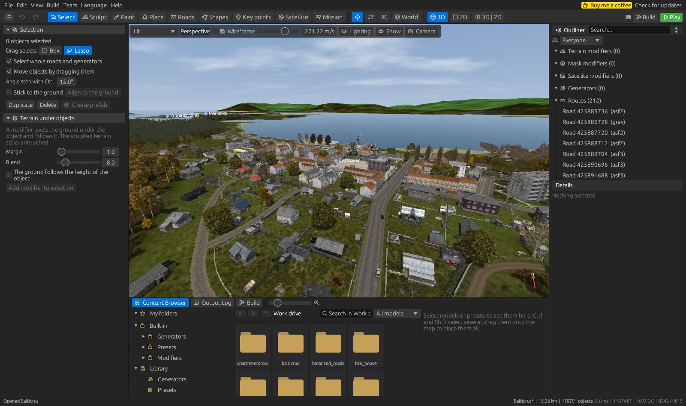
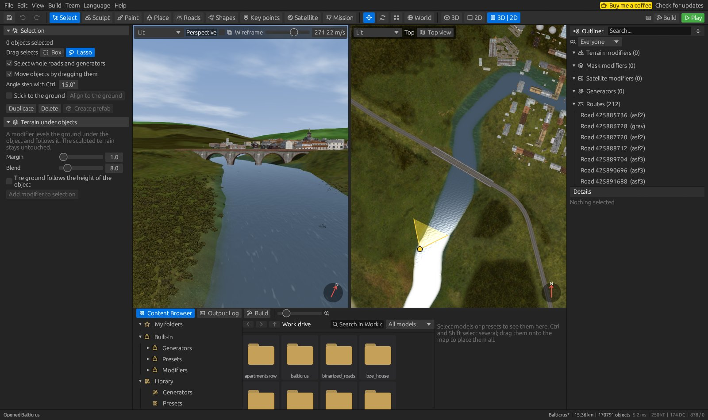
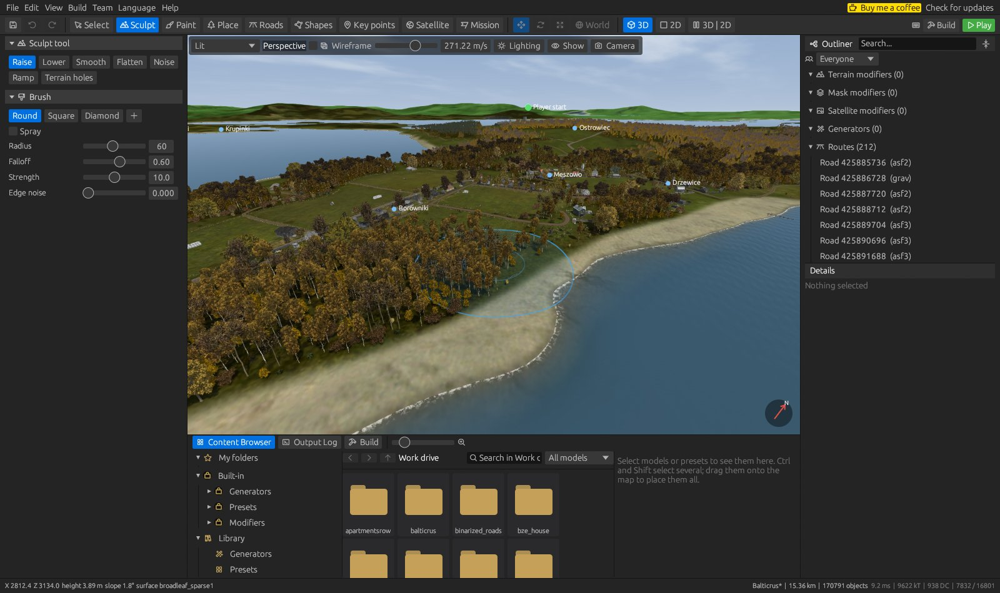
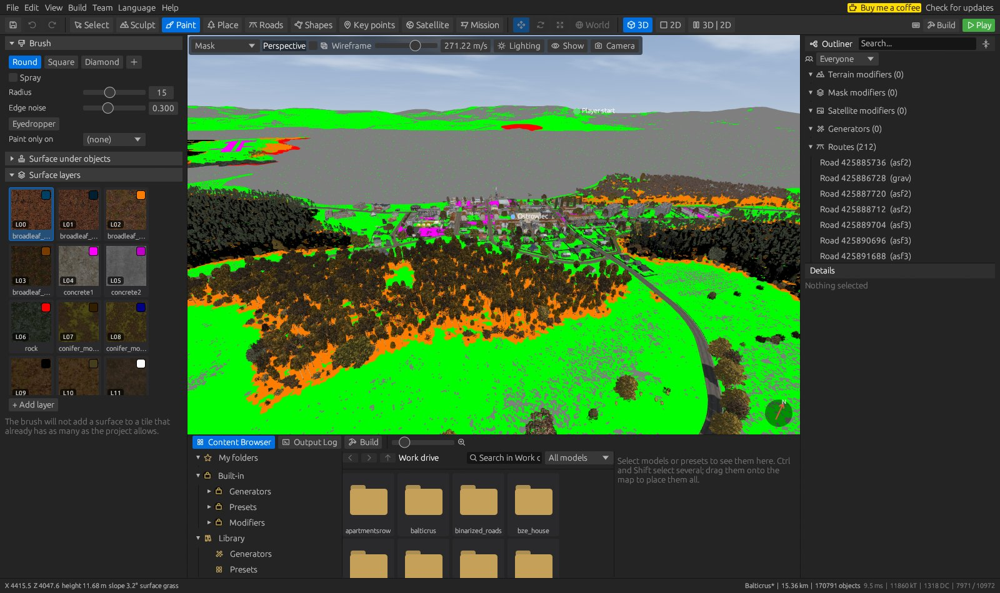
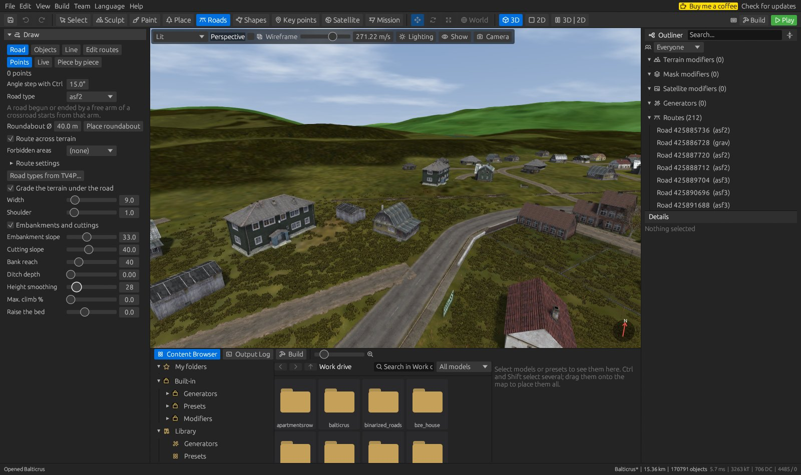
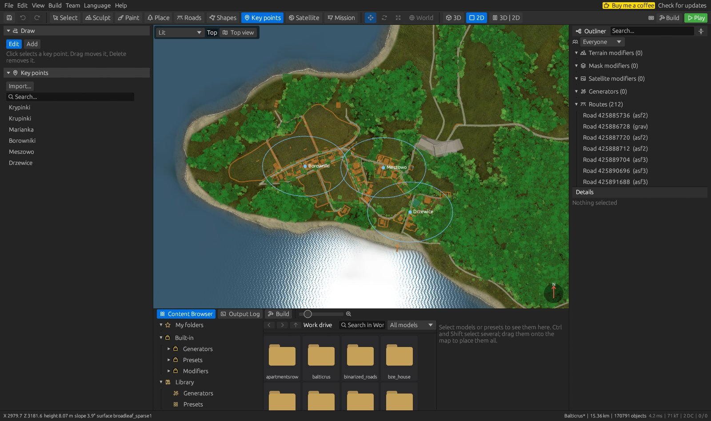
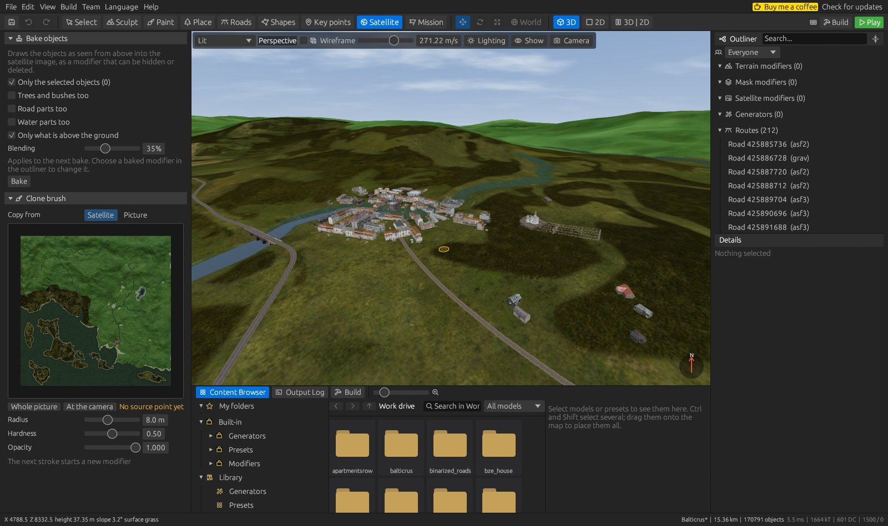
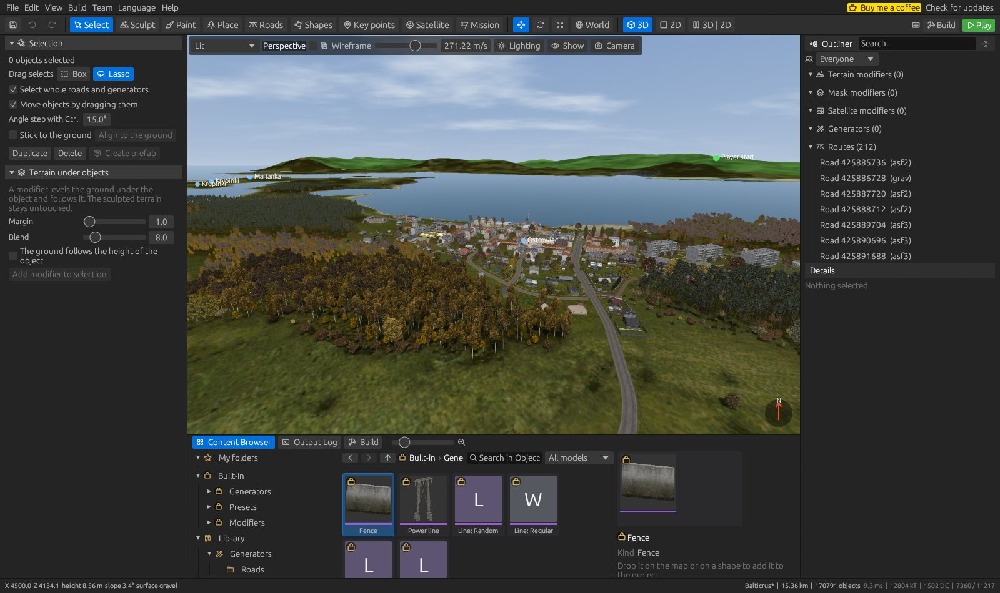

# Editor guide

This guide walks through the window of DZ World Editor, the views, every tab and the menus.
For the server mission see [mission-editor.md](mission-editor.md), for several people on one map
[team-work.md](team-work.md).

## The window

* **Menu bar**: File, Edit, View, Build, Team (with experimental features on), Language and Help.
  On the right, *Check for updates* and the installer of a new release.
* **Toolbar**: Save, Undo and Redo, the nine tabs (keys 1-9), the gizmo (Move, Rotate, Scale and
  World or Local axes), the views (3D, 2D, 3D | 2D) and **Build** and **Play**.
* **Left panel**: the settings of the current tab.
* **View**: the map in 3D, in 2D, or both side by side.
* **Outliner** (right): terrain, mask and satellite modifiers, generators, roads and object
  layers. Click one to select it; the **Details** below it shows and changes what is selected.
* **Bottom panel**: the **Content Browser**, the **Output Log** and the **Build** tab.
* **Status bar**: the position, height, slope and surface under the pointer, the map and the number
  of objects, and what the renderer draws.

## Views and camera

| | |
| --- | --- |
| 3D view (Ctrl+1) | Hold the right mouse button and fly with WASD, Q and E. Shift is faster, the wheel changes the speed while the right button is held. F frames the selection, B lets the camera below the terrain. |
| 2D view (Ctrl+2) | A view from the top. The wheel zooms, the middle or right button pans. Close up, it draws the models themselves, as a drone sees them. |
| 3D \| 2D (Ctrl+3) | Both views side by side. The top view can follow the 3D camera, and the two can be swapped or stacked. |

The bar at the top of each view chooses the shading (Lit, Satellite, Mask, Hillshade, Height,
Slope), wireframe, the speed of the camera, **Lighting** (sun, shadows), **Show** and **Camera**.
**Show** and the View menu turn parts of the map on and off: grass (G), objects (H), shapes
(Shift+H), the land grid and texture tiles.

`View > Full screen` (F11) gives the whole screen to the view; move the pointer to an edge for the
panels. `View > View in a separate window` moves the view to a window of its own, for example on
another screen. The minimap in the corner of the 3D view can be dragged bigger or smaller and turned
off in the settings.

## Tabs

### 1 Select

Click selects an object, a drag selects with a box or a lasso, Shift adds. W, E and R switch the
gizmo between move, rotate and scale, L between world and local axes. With objects selected, a drag
with Shift held turns them, Ctrl+Shift turns them by steps (the wheel changes the step) and Alt
scales them.

* **Select whole roads and generators** picks a road or a generator as a whole instead of its
  objects.
* **Move objects by dragging them**: an object held by its shape slides over the ground.
* **Stick to the ground** tilts moved objects with the ground; **Align to the ground** does it now.
* **Duplicate** (Ctrl+D) and **Delete**. C copies the selection to the cursor, V copies the last
  selection there again.
* **Create prefab** makes a reusable group of the selected objects in the library.
* **Terrain under objects** adds a terrain modifier that levels the ground under the selection and
  follows the objects when they move. The sculpted terrain stays untouched.

### 2 Sculpt

Raise, Lower, Smooth, Flatten, Noise, Ramp and **Terrain holes**. The brush is round, square,
diamond or a picture of your own, with radius, falloff, strength, edge noise and spray. Ctrl inverts
the tool, Shift smooths. `[` and `]` change the size, Shift+`[` and Shift+`]` the strength; with the
wheel, Shift changes the size, Alt the strength and Ctrl the edge noise. These modifier keys can be
changed in the keyboard shortcuts.

Larger changes of the terrain are generators (terrain shape, erosion, terraces) and modifiers, which
stay editable: they are listed in the outliner and can be changed, hidden or deleted later.

### 3 Paint

Paints the surface mask with the layers of the project, which come from the surfaces of
`P:\dz\surfaces*` or a `layers.cfg`. The brush has the same shapes as in Sculpt, with edge noise and
spray; the **Eyedropper** (or Alt) picks the surface under the pointer, and **Paint only on** limits
the brush to one surface. **Surface under objects** stamps a surface under the objects, buildings by
their footprint.

The game can draw only a limited number of surfaces on one texture tile. The brush does not add a
surface to a tile that already has as many as the project allows (up to six), so what you paint is
what the game shows. The *Mask* shading of the view shows the mask in its colours, as above.

### 4 Place

Choose a model in the Content Browser and click on the terrain, or drag models onto the map.
**Paint with a brush** places objects as you drag, with radius and spacing. Random rotation, align to
slope and a scale range apply to every object placed. An **object preset** places one of several
models with its own settings.

### 5 Roads

* **Road** lays a road or a railway of the chosen type. Clicks set the points (**Points**), the road
  follows the pointer (**Live**), or it is laid one part at a time (**Piece by piece**: Space lays the
  part, Z and X choose another, S curves to the other side).
* Every vanilla road type of Chernarus, Livonia, Sakhal and Takistan is available, and crossroads
  (`kr_*`): a road begun or ended at a free arm of a crossroad starts from that arm.
* **Roundabout** places a round roundabout of the given diameter.
* **Route across terrain** finds a path over the hills, avoiding the **forbidden areas** (shapes).
* **Grade the terrain under the road** with width, shoulder, embankments and cuttings, ditches and
  the greatest climb. Roads keep their bridges, and where a road crosses a railway the track gets a
  level crossing.
* **Objects** places objects along a line (fences, walls), **Line** draws a plain line, and **Edit
  routes** moves the points of existing roads.

### 6 Shapes

Polygons, lines and points that generators work on, in layers. They can be imported from SHP and
TV4S files and exported to SHP.

### 7 Key points

Named places of the map (cities, villages, hills...) as Terrain Builder has them. **Add** places a
new one, **Edit** selects, moves and deletes them; **Import...** reads them from a file. They are
written to the `Names` of the world config on export, so the in-game map shows them.

### 8 Satellite

* **Bake objects** draws the objects as seen from above into the satellite image: the selected ones
  or all, optionally trees and bushes, road parts and water parts, only what is above the ground, with
  a blending of the edges.
* **Clone brush** copies from another place of the satellite image or from a picture you load.
  Choose the source in the preview, then paint on the map.

Every bake and every clone stroke is a **satellite modifier** in the outliner: it can be hidden or
deleted, and what it covered comes back.

### 9 Mission

The server mission of the map: event and player spawns, territories, effect areas and the rest. It is
an experimental feature; see [mission-editor.md](mission-editor.md).

## Generators and the Content Browser

The Content Browser at the bottom holds:

* **Work drive**: every model of `P:\`, with thumbnails and a search.
* **Built-in**: generators, object presets and modifiers that come with the editor. They cannot be
  changed, only duplicated.
* **Library**: your own generators, presets and prefabs, in folders.
* **My folders**: models and presets you collect yourself, and Terrain Builder template libraries.

A generator is dropped on a shape, a road or the map (or select the shape first and double-click
the generator). It appears in the outliner, where its settings can be changed and it can be run
again.

| Generators | |
| --- | --- |
| Vegetation | Forest with extra presets and edges, area and line scatter methods |
| Water | Rivers from the game's straight and bend models, ponds and lakes that dig their own basins |
| Settlements and lines | Settlement, fence, power line |
| Terrain | Terrain shape, hydraulic and thermal erosion, terraces, terrain along a line |
| Surfaces and clean-up | Rule-based surface painting, removing objects by category or name |

## Menus

### File

* **New project**, **Open project**, **Recent projects**, **Save** and **Save as**.
* **Import**: a Terrain Builder or built map folder, a WRP world, and to an open project a heightmap
  (ASC), satellite image, mask image, `layers.cfg`, Terrain Builder layers (TV4L) and objects (TXT),
  DayZForests and Road Studio projects, roads from TV4P and shapes (SHP, TV4S).
* **Export**: all files at once or one at a time (heightmap, satellite image, mask, `layers.cfg`,
  objects, shapes, server mission).
* **Project settings**: name, size and the other settings of the map.
* **Map config**: the `CfgWorlds` entry written to `config.cpp`: the name the game shows, the world
  the map is built on, the sea, the map centre, latitude and longitude, the grid of the in-game map,
  and the main menu scenes, which can be taken from where the 3D camera stands.

### Edit

Undo and Redo name what they undo. **Settings** (Ctrl+,) has the paths of DayZ and DayZ Tools, the
display and graphics, backups and the experimental features. **Keyboard shortcuts** (F1) changes
every key, and which modifier keys the brushes use.

### Build

* **Export files for the PBO**, or **with Terrain Builder sources** as well.
* **Build PBO** (F7) and **Build and play** (F5): see *Building a map* in the [README](../README.md).
* **Generate navmesh** starts the data server and NavMeshGenerator.

### Language

English, Polish and German, and any language added as a JSON file in the language folder.
