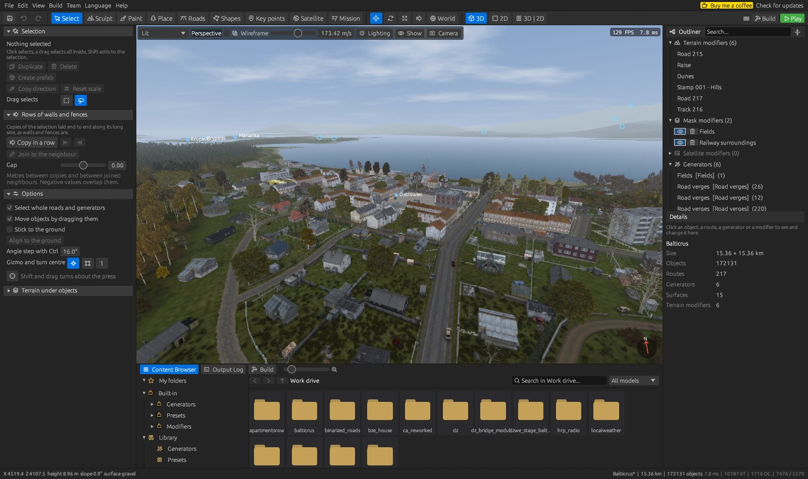

# Editor guide

This guide walks through the window of DZ World Editor, the views, the tabs and the menus. Each
tab has a page of its own:

* [Objects](objects.md): Select and Place, rows of walls and fences
* [Terrain](terrain.md): Sculpt
* [Surfaces](surfaces.md): Paint, surfaces from the satellite, map surfaces
* [Roads](roads.md)
* [Shapes and key points](shapes.md)
* [Satellite image](satellite.md)
* [Generators and the Content Browser](generators.md)
* [Maps of real places](real-places.md)
* [Server mission](mission-editor.md) and [team work](team-work.md)

## The window

* **Title bar**: the editor draws its own, with the menus in it: File, Edit,
  View, Build, Team, Language and Help, the name of the project in the middle (a yellow dot while it
  has unsaved changes), *Check for updates* and the buttons of the window. Drag it to move the window,
  double click it to fill the screen. `Edit > Settings > Display > Own title bar` brings back the
  usual Windows title bar.
* **Toolbar**: Save, Undo and Redo, the nine tabs (keys 1-9), the gizmo (Move, Rotate, Scale, Copy in
  a row, and World or Local axes), snapping (the grid: when on, moving along an arrow or over the
  ground goes by its step, 1 m at first, as Ctrl does while held; the angle step that Ctrl turns
  by; **Ground**, objects that stick to the ground; and **Surface**, placing objects on top of other
  objects, `Shift+End`), the views (3D, 2D, 3D | 2D) and **Build** and **Play**.
* **Tools** (left): the settings of the current tab. The panel is named after the tab.
* **Viewport**: the map in 3D, in 2D, or both side by side, with a thin yellow frame.
* **Outliner** (right): terrain, mask and satellite modifiers, generators, roads and object
  layers. Click one to select it; the **Details** below it shows and changes what is selected.
* **Content Browser**, **Output Log** and **Build** under the view.
* **Status bar**: the position, height, slope and surface under the pointer, the map and the number
  of objects, and what the renderer draws.

Every panel is a tab. Drag a tab by its title onto another panel to put
them together, onto the edge of a panel to split it, or out of the window to let it float. Right
click a tab to close it or float it. **View > Window layout** opens closed panels again and has
**Default layout**, which puts everything back. The layout is kept for the next start.

Numbers in the panels are dark fields that fill with blue up to their value: drag across a field to
change it, or click it to type a value and press Enter (Esc leaves it as it was). The tools of a tab
are tiles with their picture over their name; the line under them tells what the chosen one does,
in full under the pointer.

## Views and camera

| | |
| --- | --- |
| 3D view (Ctrl+1) | Hold the right mouse button and fly with WASD, Q and E. Shift is faster, the wheel changes the speed while the right button is held. F frames the selection, B lets the camera below the terrain. |
| 2D view (Ctrl+2) | A view from the top. The wheel zooms, the middle or right button pans. Close up, it draws the models themselves, as a drone sees them. |
| 3D \| 2D (Ctrl+3) | Both views side by side. The top view can follow the 3D camera, and the two can be swapped or stacked. |

**View > Measure** (ruler) measures on the map: each click adds a point, and the view shows the
length on the map and along the ground, the climb from the first point to the last and, from three
points, the area they close. Backspace takes the last point back, Esc or a right click ends.
**View > Saved views** keeps places of the 3D camera in the project to go back to with a click.
**View > Go to** (Ctrl+G) flies the camera to a place. Type the name of a key point, a square of the
game's map grid (`045 123`: the east number first, squares of 100 m from the south west corner) or
metres east and north with a comma (`4500, 12300`), and press Enter. Right click a key point, modifier,
generator, road, shape, shape layer or model in the Outliner and choose **Move the camera here** to
fly to it.

The bar at the top of each view chooses the shading (Lit, Satellite, Mask, Hillshade, Height,
Slope — coloured by DayZ vehicle and foot thresholds, Object density, Water flow), wireframe, the speed of the camera, **Lighting** (sun, shadows), **Show** and **Camera**.
**Lighting** also has **Time of day** and **Overcast**: the sun of that hour at the map's
latitude and start date, weaker and with more fog under cloud. **Camera** also chooses whether
the grass (clutter) draw distance uses the editor slider or the map's own **Map config**
(`clutterDist` and `clutterGrid`). **Show** and the View menu turn parts of the map on and off: grass (G), objects (H), shapes
(Shift+H), the land grid and texture tiles.

`View > Full screen` (F11) gives the whole screen to the view; move the pointer to an edge for the
panels. `View > View in a separate window` moves the view to a window of its own, for example on
another screen. The minimap in the corner of the 3D view can be dragged bigger or smaller and turned
off in the settings.

## Tabs

### 1 Select

Select, move, turn, scale, copy and delete objects; rows of walls and fences; terrain under objects. See [Objects](objects.md). The surface under objects is in [Surfaces](surfaces.md).

### 2 Sculpt

Brushes, terrain holes, procedural terrain, erosion, terraces, terrain stamps and terrain modifiers. See [Terrain](terrain.md).

### 3 Paint

Paints the surface mask, reads it from the satellite, stamps surfaces under objects, and sets up the map's surfaces and layer materials. See [Surfaces](surfaces.md).

### 4 Place

Places models and object presets with a click or a brush. See [Objects](objects.md#place).

### 5 Roads

Roads and railways fitted from the game's own parts, with bridges, crossroads and roundabouts. See [Roads](roads.md).

### 6 Shapes

Polygons, polylines and points, from files or drawn, for generators and masks. See [Shapes and key points](shapes.md).

### 7 Key points

Named places of the map. See [Shapes and key points](shapes.md#key-points).

### 8 Satellite

Bakes objects, decals and realistic water (ocean, rivers and ponds) into the satellite image, clone and colour brushes, colour correction and a satellite from the mask. See [Satellite image](satellite.md).

### 9 Mission

The server mission of the map: event and player spawns, territories, effect areas and the rest. It is
an experimental feature; see [mission-editor.md](mission-editor.md).

## Generators and the Content Browser

Generators for forests, water, fields, settlements, fences and more, and the Content Browser with the models, presets and library. See [Generators and the Content Browser](generators.md).

## Menus

### File

* **New project**, **Open project**, **Recent projects**, **Save** and **Save as**.
* **New project from a real place**: a map of a real square of the Earth, with its satellite
  picture, heights, OpenStreetMap shapes, a surface mask, buildings, roads and generators. See
  [Maps of real places](real-places.md).
* **Import**: a Terrain Builder or built map folder, a WRP world, and to an open project a heightmap
  (ASC), satellite image, mask image, `layers.cfg`, Terrain Builder layers (TV4L) and objects (TXT),
  DayZ Editor (`.dze`) and Object Spawner JSON (`cfggameplay.json`),
  DayZForests and Road Studio projects, roads from TV4P and shapes (SHP, TV4S).
* **Export**: all files at once or one at a time (heightmap, satellite image, mask, `layers.cfg`,
  objects, DayZ Editor `.dze` and Object Spawner JSON, a 2D player map PNG up to full map resolution
  with contours, roads, buildings, tree/bush canopy, grid and key points in a chosen font and size,
  shapes, server mission).
* **Project settings**: name, size and the other settings of the map.
* **Map config**: the `CfgWorlds` entry written to `config.cpp`: the name the game shows, the world
  the map is built on, the sea and waves, atmosphere and sky, ambient sound map, navmesh settings,
  terrain blending and clutter, the map centre, latitude and longitude, the grid of the in-game map,
  and the main menu scenes, which can be taken from where the 3D camera stands.

### Edit

Undo and Redo name what they undo. **Settings** (Ctrl+,) has the paths of DayZ and DayZ Tools, the
display and graphics, backups and the experimental features. **Keyboard shortcuts** (F1) changes
every key, and which modifier keys the brushes use.

### Build

* **Export files for the PBO**, or **with Terrain Builder sources** as well.
* **Build PBO** (F7) and **Build and play** (F5): see *Building a map* in the [README](../README.md).
* **Generate navmesh** starts the data server and NavMeshGenerator.
* **Check the map** lists what would break the build or the game (errors: models or surface
  textures missing from the work drive, no satellite image, a wrong map id) and what is most
  likely a mistake (warnings: objects hanging over the ground or wholly under it, trees and
  buildings in the sea, objects outside the map, the same object twice in one place, houses
  standing in one another, very dense areas with 800 or more objects in a 100 m square, roads without parts, a player start in the sea, errors of the mission).
  A click goes to the place and selects the objects; doubled objects and those outside the map can
  be deleted from the list. Building checks the map first and waits on errors until they are
  fixed or you choose **Build anyway**; this can be turned off on the Build tab.

The **Build** tab at the bottom shows what the build makes, its latest output and these settings:

* **Also built into the mod**: other folders of the work drive (your own buildings, for example).
  Each becomes a PBO of its own with its path as the prefix, binarised or packed as it is.
* **Signing**: a `.biprivatekey` made with DSUtils signs the built PBOs; the public key is copied into
  `Keys` of the mod.
* **Playing**: whether **Play** starts the game client too, and other mods to load with the map.

### Language

English, Polish and German, and any language added as a JSON file in the language folder. The editor
starts in the language of Windows when it has it, and in English otherwise.
