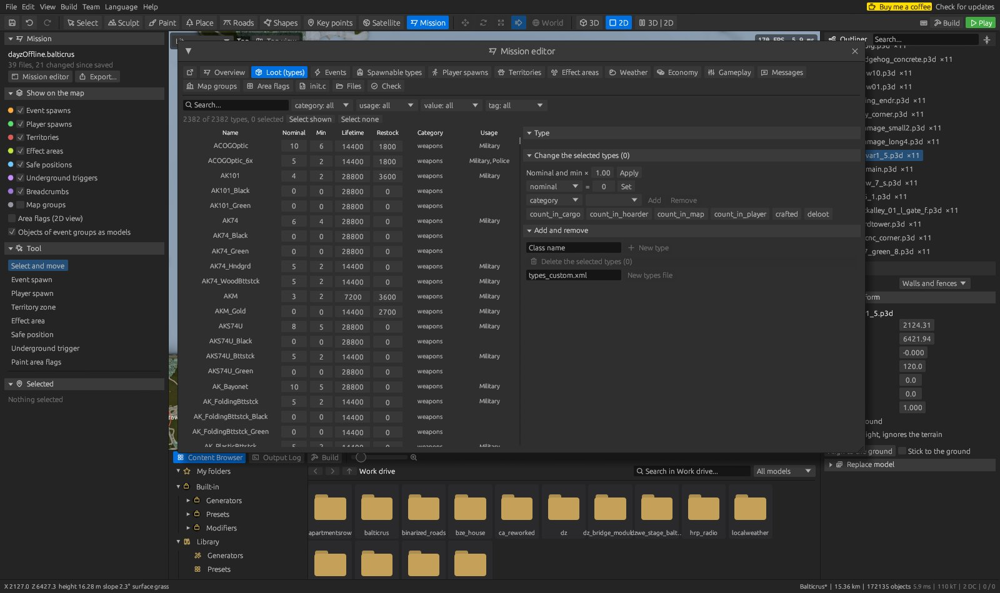

# Mission editor

The **Mission** mode (key 9) edits the server mission of the map: the folder the server
reads from `mpmissions\dayzOffline.<world>`. The mission lives in `mission\` of the project
and is written there exactly as the server reads it. The mission editor is an experimental
feature: turn it on with *Edit > Settings > General > Show experimental features*.

The left panel of the Mission mode chooses what the map shows (event spawns, player spawns,
territories, effect areas, safe positions, underground triggers, breadcrumbs, map groups, area flags)
and the tool the map uses: select and move, or place one of these. **Mission editor** opens the
window with the tabs below.

* **New mission for this map** makes every file a server needs, with the game's defaults,
  a blank `areaflags.map` over the map and one player spawn at the map's spawn point.
* **New mission with the economy of the game** starts from the economy of a world of the game
  (`DZ\worlds\<world>\ce`): its loot, events and prototypes, with map groups made from this map's
  buildings and infected zones at its villages and towns. Vehicles, events and area flags are still
  to be placed on the map.
* **Import a mission** reads a mission folder as it is.
* **Adapt a mission of another map** keeps the economy of a mission (types, events, globals,
  weather, prototypes...) and drops what was placed on the other map: event spawns, player
  spawns, territory zones, effect areas, triggers, map groups, cluster files, area flags and
  persistence.
* **Export** (Mission editor, or *File > Export > Server mission*) writes the folder anywhere;
  **Play** starts the test server with it.

The map carries its own Central Economy, as the worlds of the game do: export writes the project's
mission to `<map>\ce` with a config of its own, `ceFiles` of the world config points at it, and the
build packs it as `ce.pbo`. A `ce` folder the editor did not write is left alone.

Files nobody edited are copied byte for byte. Edited files are rewritten with the indentation
and line ends they had; comments and elements the editor does not know stay where they were.
Every vanilla mission of BohemiaInteractive/DayZ-Central-Economy reads and writes back without
losing anything (`DZWE_CE_DIR=<checkout> cargo test -p dz-core mission`).

## Files

| File | What it controls | Where to edit it |
|---|---|---|
| `init.c` | Starts the economy, resets the date, gives new characters their items | init.c tab: date reset, health of starting items, CE export calls, the whole script |
| `cfgeconomycore.xml` | Root classes, defaults and logging of the economy; extra files in `ce` folders | Economy tab; *New types file* adds a file to it |
| `cfgenvironment.xml` | Which `env` files each animal and infected territory uses | Territories tab |
| `cfgeventgroups.xml` | Objects an event spawns together (trains with wagons) | Spawnable types tab |
| `cfgeventspawns.xml` | Where each event may spawn, with zones and groups | Events tab, *Event spawn* tool on the map |
| `cfgplayerspawnpoints.xml` | Spawns of fresh players, after hopping and after travel, with their parameters | Player spawns tab, *Player spawn* tool, groups from key points |
| `cfgrandompresets.xml` | Named sets of cargo and attachments with chances | Spawnable types tab |
| `cfgspawnabletypes.xml` | Cargo, attachments, damage and hoarder flag items spawn with | Spawnable types tab |
| `cfgweather.xml` | Overcast, fog, rain, wind, snowfall, storms | Weather tab |
| `cfgignorelist.xml` | Types the cleanup leaves alone | Spawnable types tab |
| `cfglimitsdefinition.xml` | Names of categories, tags, usage and value flags | Economy tab (limits); their order is the bit order of `areaflags.map` |
| `cfglimitsdefinitionuser.xml` | Named groups of usage and value flags | Economy tab |
| `cfggameplay.json` | Stamina, base building, map, UI and other gameplay settings | Gameplay tab |
| `cfgeffectarea.json` | Contaminated and other effect areas, safe positions | Effect areas tab, *Effect area* and *Safe position* tools, areas from shapes |
| `cfgundergroundtriggers.json` | Trigger boxes darkening the view underground, breadcrumbs | Effect areas tab, *Underground trigger* tool |
| `mapgroupproto.xml` | Loot points of each building class | Map groups tab; 3D loot point editor from the Content Browser right-click menu |
| `mapgrouppos.xml` | Buildings of the map that hold loot, with position and angles | Map groups tab: made from the placed objects |
| `mapclusterproto.xml` | Loot of clusters (fruit trees, stones) and the models that are clusters | Map groups tab |
| `mapgroupcluster*.xml` | Cluster objects of the map | Made from the placed objects; otherwise copied as they are |
| `mapgroupdirt.xml` | Dirt piles; usually empty | Files tab |
| `db/types.xml` (and type files of `ce` folders) | Every item: nominal, min, lifetime, restock, quantities, cost, flags, category, usage, value, tags | Loot tab: search, filters, table, bulk edit |
| `db/events.xml` | Dynamic events and their children | Events tab |
| `db/globals.xml` | Global numbers of the economy | Economy tab, with what each does |
| `db/economy.xml` | Which parts start, load, respawn and save | Economy tab |
| `db/messages.xml` | Server messages | Messages tab |
| `env/*.xml` | Territory zones of animals and infected | Territories tab, *Territory zone* tool, zones from key points |
| `areaflags.map` | Usage and value flags over the map | Area flags tab, *Paint area flags* tool, fill from shapes |
| `storage_*` | Persistence: what is on the map now | Overview: size, wipe; export copies it only when asked |

Anything else (mod configs, `config.cpp`, `pra\...`) is kept and copied. The Files tab edits
every XML and JSON file as a tree and `.c` files as text.

## areaflags.map

Little-endian: cells across, cells down, world width and height in metres (four `u32`), then
the usage layer (`u32` bits per cell, then the cells) and the value layer (bits per cell, then
the cells). Rows start at the south edge (z = 0). Cells smaller than a byte fill it from the low
bits. Bit *n* of a usage cell is the *n*-th usage flag of `cfglimitsdefinition.xml`, bit *n* of a
value cell its *n*-th value flag. The game uses 32 bits for usage and the next power of two of
the number of value flags (8 for five, 4 for four).

## mapgrouppos.xml

`pos` is the position of the object as the WRP stores it; `rpy` is roll, pitch and yaw in
degrees, the yaw turning from the north towards the east (`atan2(dir.x, dir.z)` of the model's
direction vector); `a` is 90° less the yaw, wrapped to (-180, 180]. Checked against the
binarised Chernarus WRP.

## mapgroupproto.xml (3D loot point editor)

When the project has a server mission, right-click any building model in the **Content Browser**
and choose **Edit loot points (mapgroupproto.xml)...** (or **Add to mapgroupproto.xml...** when
the building has no entry yet) to open a standalone 3D preview and editor window:

* **3D navigation**: uses the same GPU 3D fly-camera as the main terrain view — hold RMB and fly
  with WASD/QE (Shift for faster movement, wheel while holding RMB for speed), wheel to zoom, MMB
  to pan, `F` to frame the selected point, or use the **Iso**, **Top**, **Front**, **Side** and
  **Inside** camera presets to fly straight inside rooms.
* **Cut roof**: slides a horizontal clip plane down through the building in real time so upper
  floors and interiors are easy to inspect.
* **Placing and editing points**: the 3D view renders both the building and its visual **Proxies**
  (furniture, tables, shelves). Turn on **Click 3D to add** and click any floor, table or shelf
  (with a live target ring) to place a `<point>` in model coordinates (relative to the model's
  bounding centre, matching DayZ). On the selected point, drag the 3D **X/Y/Z gizmo** arrows to
  fine-tune its position, drag the horizontal **range ring** to resize `range`, or drag the top
  **H** handle to adjust `height` clearance; drag the divider between the left inspector and the 3D
  view to resize the layout. Edit group `lootmax`, `deloot`, `usage` and `value` flags, containers (`lootFloor`,
  `lootshelves`...) with `categories` and `tags`, and each point's `pos`, `range`, `height` and
  outdoor `flags="32"`, then click **Save to mapgroupproto.xml**.

## Checks

The Check tab looks at the references between files: categories, tags, usage and value flags
the limits do not define, presets, event groups and files that are named but missing, events
with fixed positions but no spawns, zones naming no event, places outside the map, duplicate
types, prototypes for the buildings in `mapgrouppos.xml`, and whether `areaflags.map` fits the
map and the limits.

## Static events and event groups

Static events (`StaticMilitaryConvoy`, `StaticTrain`, `StaticPoliceSituation`...) have no
`<children>` in `events.xml`. Each `<pos>` of the event in `cfgeventspawns.xml` names a
`group` of `cfgeventgroups.xml` and gives the absolute height `y`; the game places every
`<child>` of the group at the spawn plus its `x`, `z` offset (along the axes of the map; every
vanilla group spawn has `a="0"`), at `y` over the spawn when the child has one, else on the
ground, turned by its `a`. `deloot="1"` with `lootmin`/`lootmax` gives the object loot of the
dynamic event; `spawnsecondary="false"` keeps the secondary event (infected) away from it.
The `<zone>` of the event sets the infected around each spawn.

The map draws the objects of the group around each spawn (filled: with loot). The Events tab
lists the groups an event places and edits them as a table; a group can be made from props
placed on the map: select them, name the group, and the first object becomes the spawn. Class
names are guessed from the models (`StaticObj_`/`Land_`, optionally `_DE`) and can be changed.

The class of each object gives its model through `CfgVehicles` of the configs of the work
drive (read once in the background, inheritance included); the Mission mode draws every object
of every group as its model at each spawn. In the asset browser the context menu of a prefab
makes a new event group laid out as the prefab (its middle stands at the spawn) or adds it to a
group; the class of each object is the one the configs give
the model (the `_DE` variant when asked for). The mission editor can be a window of its own
(the button left of the tabs), outside the program and on another screen.
