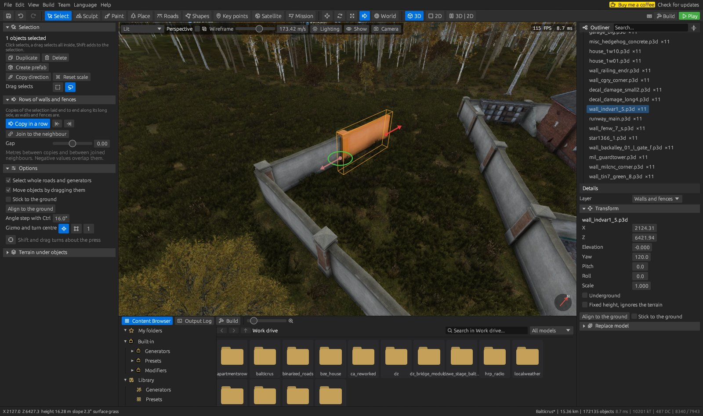

# Objects

## Select

Click selects an object, a drag selects with a box or a lasso. Shift or Ctrl with a click turns one
object on or off. Shift+Alt with a drag adds what the box or lasso holds (with nothing selected yet,
Shift alone does too), and Ctrl with a drag takes it out of the selection (the box turns red). W, E, R and T switch the
gizmo between move, rotate, scale and copy in a row, L between world and local axes. With objects selected, a drag
with Shift held turns them, Ctrl+Shift turns them by steps (the wheel changes the step) and Alt
scales them.

* **Select whole roads and generators** picks a road or a generator as a whole instead of its
  objects.
* **Move objects by dragging them**: an object held by its shape slides over the ground.
* **Gizmo and turn centre** chooses where the gizmo stands and what the selection turns about: the average of the object positions (the default), the middle of the box that holds them, or the first selected object. Only positions count; the models are not looked into. **Shift and drag turns about the press** makes a Shift drag turn the selection about the spot of the ground where the button went down.
* **Stick to the ground** tilts moved objects with the ground; **Align to the ground** does it now.
* **Drop onto surface** (`End`) drops the selected objects onto the surface of objects under them
  (such as roofs, tables or floors), or onto the terrain when nothing is below.
* **Hide selected** (`Ctrl+H`), **Isolate selection** (`/`) and **Show hidden** (`Alt+H`, also in
  the Edit menu) temporarily hide objects in the view while you work on a tight interior or dense
  area. Hidden objects stay in the project and come back when shown or when the project is reopened.
* **Duplicate** (Ctrl+D) and **Delete**. C copies the selection to the cursor, V copies the last
  selection there again.
* **Copy direction**: click it, then click another object. The selection turns the way that object
  faces, so a broken wall lines up with the wall next to it. With *Stick to the ground* only the
  heading is taken and the objects tilt with the ground.
* **Reset scale** sets the selected objects back to their own size.
* **Stands on the ground**: walls, fences, rail tracks, sidewalks and some other models
  (about 200 in vanilla) have `placement = slopelandcontact`. The game puts their land contact
  points on the ground and does not use the elevation, so the editor shows them on the ground too.
  The Details panel says so, and where BI made a copy without land contact (`_nolc`) its button
  puts that copy in place, which keeps the elevation it is given.
* **Create prefab** makes a reusable group of the selected objects in the library.
* **Rows of walls and fences**, a section of its own, lays copies of the selection end to end:

  

  * **Copy on ahead** (Ctrl+Shift+D) and **Copy on behind** (Ctrl+Shift+A), the arrow buttons, put a
    copy of the selection right next to it along its long side and select the copy. Press again to
    lay a row of walls or fences piece by piece.
  * **Copy in a row** (T, the fourth gizmo button) shows two arrows where the selection ends along its
    long side. Drag an arrow out: an outline shows each copy that fits up to the cursor. Pull aside to
    turn the row about the end of the selection; with Ctrl it turns by the angle step (the wheel
    changes the step). When you let go the copies are laid and the last one is selected, so the next
    drag goes on from there, round a corner if you like. The green ring turns the selection about the
    point where it joins the wall or fence next to it: grab it and the selection first moves back to
    meet that end, then turns about it (with Ctrl by the angle step), so it stays joined.
  * **Join to the neighbour** (J) moves the selection so its end meets the end of the object next to
    it, for example after turning it with the usual gizmo.
  * **Copies of** is the selected objects, or an object preset: then each copy takes a model of the
    preset, drawn by its weights. A preset of a fence with its broken version at a small weight
    lays a row with a broken piece now and then. The copies step on by the length of the selection,
    so the models of the preset should be as long as it. The outlines while dragging show the
    models the copies will get.
  * **Gap** sets the metres between copies and between joined neighbours; negative values overlap
    them.
  * **Row direction** turns the way the row goes (and its arrows) from the long side of the first
    object, by any angle: drag the slider, type a value, or click 0°, 90°, 180° or -90°. For models
    whose copies belong another way, such as posts or gates.
  * **Turn copies by 180° at random** and **Random turn ±°** turn the new copies about their own
    middle, so a row shows both sides of a wall or looks less straight. The outlines while dragging
    show the turns the copies will get.
* **Terrain under objects** adds a terrain modifier that levels the ground under the selection and
  follows the objects when they move. The sculpted terrain stays untouched.

The **Details** under the outliner show the selected objects: position, angles and size, typed in,
**Underground** and **Fixed height, ignores the terrain** (the height is then measured from sea
level). **Replace model** puts another model in place of the selected objects: choose models in the
Content Browser, or drop one on it. Where the objects stand, how they are turned and their size stay;
with several models each object takes one of them.

## Place

Choose a model in the Content Browser and click on the terrain, or drag models onto the map.
Turn on **Place on top of objects** to snap newly placed models directly onto roofs, floors,
shelves or other objects instead of the ground.
**Paint with a brush** places objects as you drag, with radius, spacing and **Density** (objects per 100 m² of the zone you paint). What you paint with the button held is one zone: each part of it gets its objects once, and holding still adds nothing more. **Skip spots taken by other objects** keeps the brush out of buildings and other larger objects. Random rotation, align to
slope and a scale range apply to every object placed: each object gets a random size in the range.
An **object preset** places one of several models with its own settings; while one is chosen,
**Rotation and size** shows and changes the preset's settings.

## DayZ Editor and Object Spawner

`File > Import` and `File > Export` also read and write **DayZ Editor** (`.dze`) and
**Object Spawner JSON** (`cfggameplay.json`) object lists, so scenes built in-game can be brought
into the map or exported back out for a server.

[Back to the guide](guide.md)
