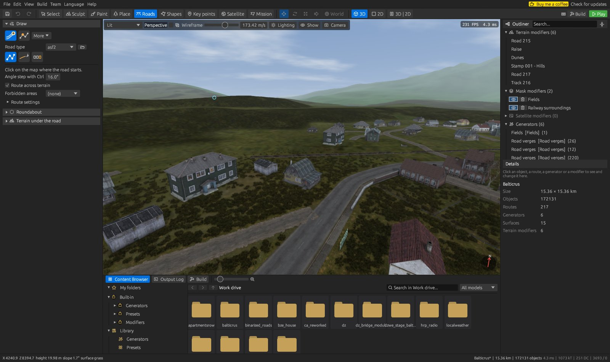

# Roads

* **Road** lays a road or a railway of the chosen type. Clicks set the points (**Points**), the road
  follows the pointer (**Live**), or it is laid one part at a time (**Piece by piece**: Space lays the
  part, Z and X choose another, S curves to the other side).
* Every vanilla road type of Chernarus, Livonia, Sakhal and Takistan is available, and crossroads
  (`kr_*`): a road begun or ended at a free arm of a crossroad starts from that arm.
* **Roundabout** places a round roundabout of the given diameter.
* **Route across terrain** finds a path over the hills, avoiding the **forbidden areas** (shapes).
* **Grade the terrain under the road** with width, shoulder, embankments and cuttings, ditches and
  the greatest climb. Roads keep their bridges, and where a road crosses a railway the track gets a
  level crossing.
* **Objects** places objects along a line (fences, walls), **Line** draws a plain line, and **Edit
  routes** moves the points of existing roads.

[Back to the guide](guide.md)
