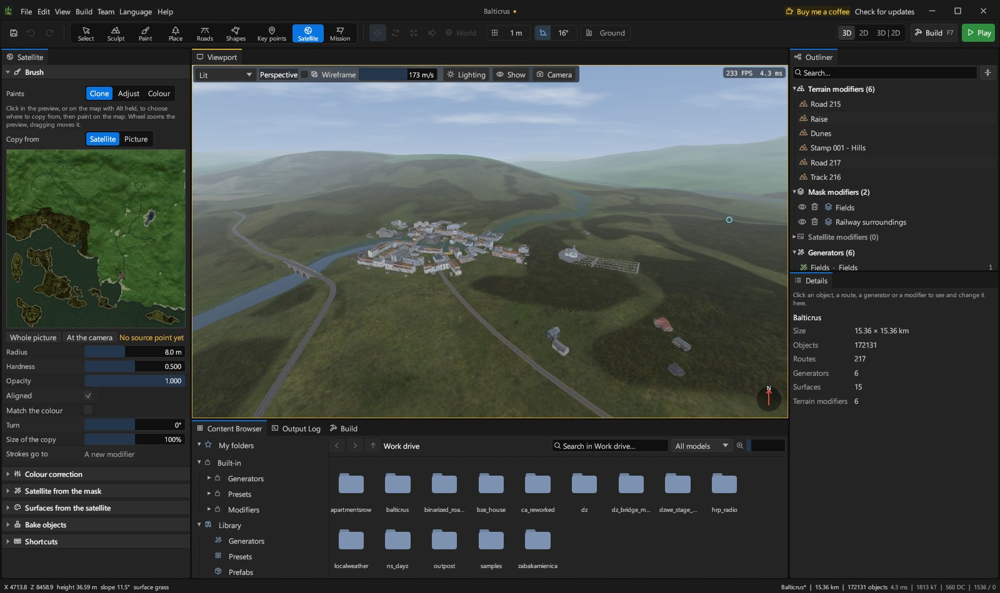

# Satellite image

* **Bake objects** draws the objects as seen from above into the satellite image: the selected ones
  or all, optionally trees and bushes, road parts, water parts and decals, only what is above the
  ground, with a blending of the edges. **Decals too** paints road damage, manholes, crossings and
  the marks under wrecks with the see-through parts of their pictures, over the roads baked with
  them; only what stands clearly above a decal (a car, a roof, a tree) hides it. Baking the whole map can leave things out, so wrecks, rubbish or fences do
  not end up in the image: turn off **Bake into the satellite** in the menu of an object layer (the
  layers of a built map are sorted by kind), or right click a model in the Outliner or the Content
  Browser and choose **Leave out of the satellite bake**. The list of left out models and path
  parts (such as `\wrecks\`) is in the Bake objects section, and is kept in the project. Objects you
  select by hand are always baked.
* **Clone brush** copies from another place of the satellite image or from a picture you load.
  Choose the source in the preview, then paint on the map.

* **Colour correction** changes the colours of the whole image or of shapes, and can be changed
  later. **Use legacy** makes brightness and contrast work as Photoshop's legacy mode.
* **Satellite from the mask** paints the image in the colours of the surfaces of the mask, with the
  pattern of their textures, ragged soft edges between them, lighter and darker patches, the
  shading of the hills and water under the sea level. Each surface gets its colour in **Colours of
  the surfaces**: guessed from its name, or taken from the satellite image the map already has. A
  project without a satellite image gets one. It works on the whole map or on shapes.

Every bake, clone stroke, correction and generated image is a **satellite modifier** in the
outliner: it can be hidden or deleted, and what it covered comes back. Everything the satellite and
mask modifiers make is part of the map when it is built.

Brushes can leave many modifiers behind. Right click a modifier of a brush (clone, adjust or colour
brush on the satellite, brush strokes on the mask) in the outliner and choose **Merge down** to
merge it into the one right under it, if that one is of the same brush and both are shown, or
**Merge all brush modifiers** to merge each run of neighbouring modifiers of one brush into one.
The image and the mask stay as they were; the merged modifier keeps the name of the lowest one, and
undo splits them again. In team work only your own modifiers are merged: merging takes the upper
one away, and a modifier of someone else would then go from their copy too.

[Back to the guide](guide.md)
