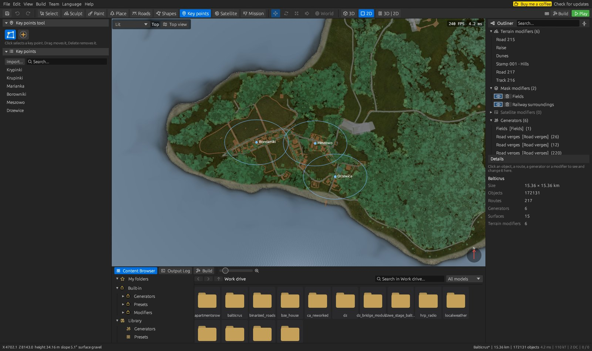

# Shapes and key points

## Shapes

Polygons, lines and points that generators work on, in layers. They can be imported from SHP and
TV4S files and exported to SHP.

**Select objects inside** (in Details, or the right-click menu of the map) selects the objects that
stand inside the selected polygons and opens the Select tool, to move or delete them. Hold Shift to
add them to what is already selected.

**Water courses from the terrain** finds the lines along which water runs down the hills and adds
them as a new shape layer, ready for the River or Stream generator. *Wetness* sets how much water
must gather for a course to start, *Shortest* leaves out the short ones. The **Water flow** shading
of the view shows the same: blue where water runs and gathers, darker where more of it does.

## Key points

Named places of the map (cities, villages, hills...) as Terrain Builder has them. **Add** places a
new one, **Edit** selects, moves and deletes them; **Import...** reads them from a file. Search the
list by name, text or type, double-click a key point (or click **Go to** in **Selected key point**)
to fly the camera there, and edit its type, text, position, angle, size and properties. They are
written to the `Names` of the world config on export, so the in-game map shows them.

[Back to the guide](guide.md)
