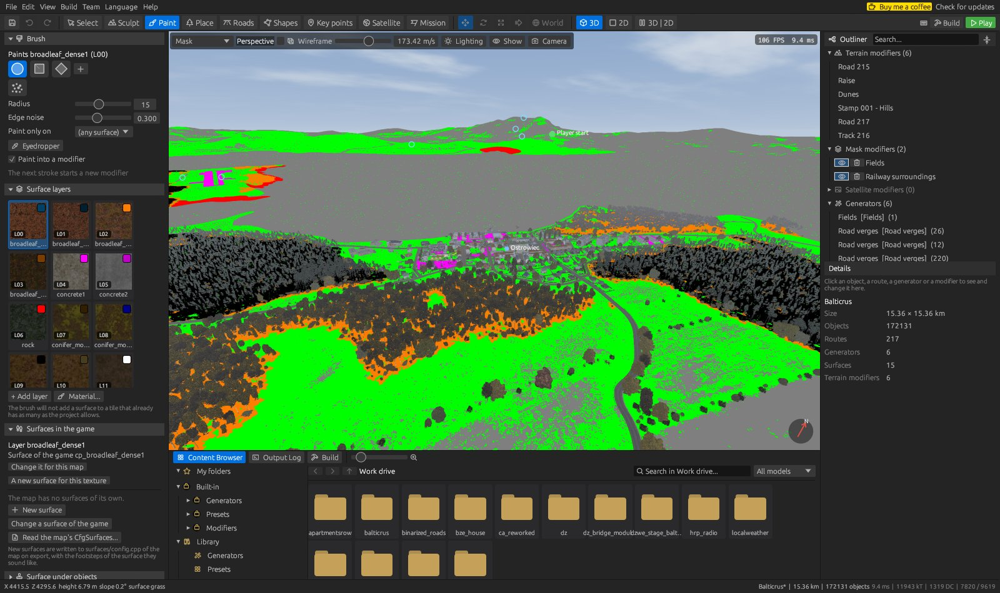

# Surfaces

Paints the surface mask with the layers of the project, which come from the surfaces of
`P:\dz\surfaces*` or a `layers.cfg`. The brush has the same shapes as in Sculpt, with edge noise and
spray; the **Eyedropper** (or Alt) picks the surface under the pointer, and **Paint only on** limits
the brush to one surface. **Surface under objects** stamps a surface under the objects, buildings by
their footprint. With the **Geometry** patch shape, **Only what is above the ground** follows only the
parts of each object above the terrain, so a rock sunk half into the ground paints round what shows
of it, as baking into the satellite does. The lists of surfaces show the texture of each and have a search field.

The game can draw only a limited number of surfaces on one texture tile. The brush does not add a
surface to a tile that already has as many as the project allows (up to six), so what you paint is
what the game shows. The *Mask* shading of the view shows the mask in its colours, as above.

To check or lower the limit on an existing map, open `File > Project settings` and set **Surfaces
per tile** (changing the limit does not alter the mask on its own). Click **Check tiles** to find
tiles over the limit and turn on **Highlight excess pixels** to mark the exact over-limit pixels in
both the 2D and 3D views alongside the tile outlines. Under **Fix options**, choose how excess
pixels are replaced (**Nearest kept surface**, **Most used surface on the tile**, or a specific
**Layer**), mark surfaces as **Protect** or **Remove first** globally or for a single tile, and fix
either **All tiles over the limit** or only the selected tile.

**Surfaces as the game shows them** (on by default, in `Edit > Settings` under the surface blending, and in the Camera menu of the 3D view)
draws the ground with the surfaces the built map will have. The game keeps the mask of each
texture tile in blocks of 4 by 4 metres with at most two surfaces each, so specks of a third surface
at an edge go, and edges follow those blocks. Surfaces blend only between neighbouring pixels, as
in the game, so a single painted pixel still shows. The view and the *Mask* shading show exactly that,
worked out by the same code as the build.

**Hard mask pixels** (off by default, in the same two places) draws each pixel of the mask as one
surface, with hard edges and no blending between surfaces. Use it to see exactly what is painted where.

**Surfaces from the satellite** reads the mask from the satellite image, in one of three ways:
* **Colour groups**: brightness and contrast (legacy) push the image to a few strong colours, as
  *Image > Adjustments > Brightness/Contrast* with *Use Legacy* does in Photoshop. Good for
  pictures made of flat colours.
* **Natural colours**: for a real satellite photo. Each pixel gets the kind of ground its colour
  looks like: dense forest, leafy forest, grass, pale grass, soil, fields, rock, and roads and
  roofs. Each kind is first given the surface whose name fits it (`forest_con`, `cp_conifer...`,
  `grass`, `stubble`...). Brightness moves the line between them: lighter makes less forest and
  more grass and rock.
* **Picked colours**: your own list of up to 16 colours, each with its surface. Each pixel takes
  the colour nearest to its own (by how different they look), so four colours make a mask of
  four surfaces. **Find colours** finds the given number of colours that stand for the picture
  best. Click the preview to add the colour of that place (**Show the picture** shows the
  satellite there to pick from), change a colour with its colour button, or remove it with the
  cross. Brightness and contrast are not used here.

The preview shows the classes, and each one can be given a surface. Smoothing takes away specks.
The result is a mask modifier.

**Material...** next to a layer opens its `.rvmat`: the colour and relief textures, a `_nopx` made from
a normal map and a height map, repeats, lighting and the raw text. Layer textures can come from
anywhere (PAA or pictures); export copies them into `<map>\data\surfaces` with their relief and
material.

**Map surfaces** (`CfgSurfaces`), lower in the panel, says which surface of the game each layer gets
in the game: its grass, footstep sounds and physics. A texture that no surface of the game is named
after has no grass in the game; **Make a surface for this layer** gives it one, built on a surface of
the game, with its own grass (with previews), sounds and physics. **Change it for this map** changes a
surface of the game for this map. **Read the map's CfgSurfaces...** takes the surfaces of an existing
config into the project. Export writes them to `surfaces/config.cpp` of the map, and the build packs
it as `surfaces.pbo`.

[Back to the guide](guide.md)
