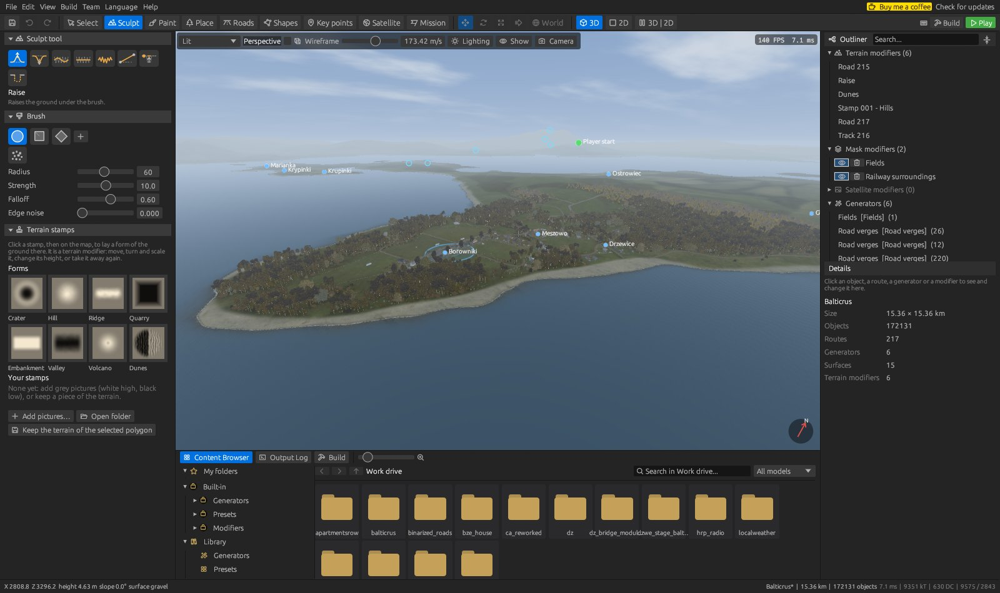

# Terrain

Raise, Lower, Smooth, Flatten, Noise, Ramp, **Set height** and **Terrain holes**; the tools are
icons, and the tip says what each one does. **Set height** paints the ground to a height you copy
from the map: right click the terrain (or Alt+click) to copy its height, then paint; the copied
height can also be typed in. The brush is round, square,
diamond or a picture of your own, with radius, falloff, strength, edge noise and spray. Ctrl inverts
the tool, Shift smooths. `[` and `]` change the size, Shift+`[` and Shift+`]` the strength; with the
wheel, Shift changes the size, Alt the strength and Ctrl the edge noise. These modifier keys can be
changed in the keyboard shortcuts.

Larger changes of the terrain are generators (terrain shape — including hills, mountains, highlands,
moraine, islands, volcanic caldera, fjords, sand desert and karst — plus erosion and terraces) and
modifiers, which stay editable: they are listed in the outliner and can be changed, hidden or
deleted later.

**Terrain stamps** lay a form of the ground: a crater, hill, ridge, quarry, embankment, valley,
volcano, dunes, plateau/mesa, bomb crater field, trench, cliff, levee/dyke or pond basin. Click a
stamp, then on the map (Esc cancels); they are also in the Content Browser under *Built-in >
Modifiers > Terrain stamps*, to drag onto the map. A stamp is a terrain modifier: with the Select
tool, a click on its dot or inside its square selects it (as does the outliner), and its details set
its size, height (below 0 turns it upside down) and turn, and its effect. Stamps shape the ground
itself: roads, rivers, ponds and pads are laid on top of them, and graded roads over a stamp follow
it again when it changes.
*Offset* adds the form to the ground as it is, *Flatten* lays it on a fixed level, *Fill* and *Cut*
only raise or only lower. Your own stamps are grey pictures (white high, black low) added with
**Add pictures…**, or a piece of the map kept with **Keep the terrain of the selected polygon**,
with a search box to filter them. They are kept in `%LOCALAPPDATA%\DZWorldEditor\stamps`.

**Terrain resolution (experimental)**: when *Show experimental features* is turned on in Settings,
the bottom of the Sculpt tab lets you resample the heightmap grid (`512`, `1024`, `2048` or `4096`)
with bicubic or linear interpolation while keeping the exact same map size in metres. Terrain holes
are remapped to the same world positions and all non-destructive terrain modifiers are re-applied.
Resizing clears undo history, so make a backup first.

When a terrain modifier is deleted (also the levelling of a road or the terrain change of a
generator), **Keep the terrain as it is for good** writes the shape it gave the ground into the
sculpted terrain, the heightmap that is exported as ASC. Without it the ground goes back to how it
was before the modifier. Projects with terrain stamps still open in versions before 0.2.6.1, only
without the stamps.

[Back to the guide](guide.md)
